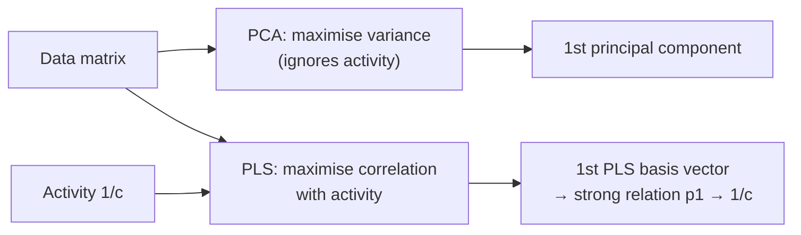

# Partial least squares (PLS)

Linear regression (least squares) under a restriction on the number of degrees of freedom:
determine an orthogonal basis z₁, z₂, … with **high predictive power**.

## Why it matters

PLS is the fix for the flaw in [[concepts/principal-component-analysis]]. Both reduce
dimensionality; PCA chooses directions by variance, PLS chooses them by **correlation with
the biological data**. In 3D-QSAR, where the activity signal can sit in a low-variance
direction, that difference decides whether the model works.

## PCA vs PLS in one picture


*Same data, different first direction — PLS tilts the basis towards whatever explains the activity.*

```text
   1/c ^                               1. PC (PCA): follows the cloud's spread
       |         p2  /        _ - - - 
       |           /   _ - -  
       |         / _ -            ← 1. basis vector (PLS):
       |       /-                    strong relation  p1 → 1/c
       +---------------------> p1
```

## Algorithm

```text
ALGORITHM PLS
INPUT   data matrix X, biological data y, maximum dimension n
OUTPUT  model of dimension s

FOR (s = 1; s <= n; s++):          // s is the dimension of the resulting model
    1. determine basis vector z_s with HIGH CORRELATION of the projected
       data matrix with the biological data
    2. add z_s to the previous model (z_1, ..., z_{s−1})
    3. compute the projected data matrix X'
    4. determine the deviation (residual):   X_r := X − Z · X'
    5. compute the predictive power of the model by CROSS-VALIDATION:
           FOR each data row d:
               compute z_s WITHOUT d and predict d
           the squared deviation is the measure of predictive power γ
    6. ABORT if γ is too low
```

Two things make this more than "PCA with a y":

- The basis is built **incrementally on the residual** `X_r = X − Z·X'`: each new component
  explains only what the previous ones left over.
- The stopping criterion is **cross-validated predictive power**, not explained variance.
  Dimension selection is therefore a validation decision, which ties directly into
  [[concepts/qsar-model-validation]].

## Caveats

- Cross-validating inside the component-selection loop means many models are generated —
  precisely the pitfall flagged in [[concepts/qsar-model-validation]] ("to evaluate the q²
  value with cross-validation, not one model but very many models are generated").
- Like PCA, the components are linear combinations of all variables; interpretation
  requires mapping back to the grid ([[concepts/3d-qsar]] visualisation).

## See also

- [[concepts/principal-component-analysis]]
- [[concepts/comfa]]
- [[concepts/qsar-model-validation]]
- [[concepts/3d-qsar]]

## Sources

- [[sources/ciw-05-pharmacophores-qsar-and-docking]] (p. 21)
