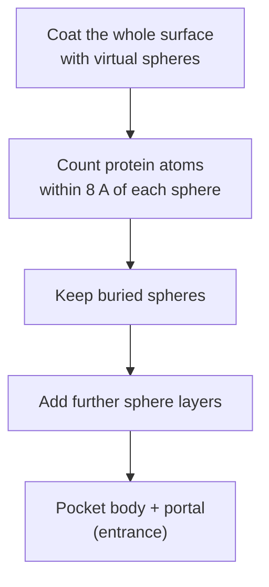

# PASS

**P**utative **A**ctive **S**ites with **S**pheres — finds binding sites by iteratively
placing virtual spheres over the *whole* protein surface and keeping the ones that turn out
to be buried.

## Why it matters

PASS inverts the usual order. [[concepts/surfnet]] fits spheres where gaps already look
promising; PASS coats the entire surface first and lets a burial criterion decide afterwards
which spheres survive. Building outwards in layers then reveals not only the pocket but its
**entrance**.

## Mechanics

```text
ALGORITHM PASS
INPUT : protein 3D structure
OUTPUT: putative active sites and their portals

A) place virtual spheres over the complete protein surface
   identify BURIED positions via the number of protein atoms
       within 8 Å of the spheres
   keep the buried spheres

B) add ADDITIONAL LAYERS of spheres on top of the kept ones
   → used to identify the 'ACTIVE SITE PORTALS'
```


*Burial is a simple atom count in an 8 Å shell; successive layers grow outwards and expose where the pocket opens.*

Reported accuracy in the notes: **63 % (1)** — the correct site is the top-ranked prediction
in about 63 % of cases.

## Caveats

- Being sphere-based, it shares the volume-overestimation problem of [[concepts/surfnet]]
  for wide pockets.
- The 8 Å radius and the atom-count threshold are fixed parameters, not derived.
- Layering makes the result dependent on the order in which spheres are added.

## See also

- [[concepts/binding-site-detection]]
- [[concepts/surfnet]]
- [[concepts/cast-alpha-shapes]]
- [[concepts/ligsite-and-pocket]]
- [[concepts/binding-site-prediction-evaluation]]

## Sources

- [[sources/ciw-06-flexible-docking-binding-sites-and-fragment-spaces]] (p. 10)
