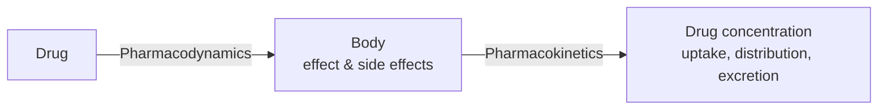

# Pharmacokinetics and Pharmacodynamics

Two complementary analyses of a drug: **pharmacodynamics** asks what the drug does to the
body, **pharmacokinetics** asks what the body does to the drug.

## Definitions

- **Arznei (medicine)** — a substance with a regulating effect on the organism and a damaging
  effect on foreign organisms.
- **Wirkstoff (active ingredient)** — the part of the medicine that is responsible for the
  pharmacological effect.
- **Pharmacodynamics** — analysis of the biological effect: which concentration at which
  location produces which effect (and which side effect).
- **Pharmacokinetics** — analysis of the drug concentration in the body: uptake and excretion.

*Pharmacodynamics: drug → body. Pharmacokinetics: body → drug concentration over time.*

## Routes of administration (Applikationsformen)

oral · parenteral · rectal · vaginal · inhalational · cutaneous

The dosage form (Darreichungsform) influences the distribution in the body, which is why it
is the first of the six boundary conditions in [[concepts/admet]].

## See also

- [[concepts/admet]]
- [[concepts/drug-discovery-pipeline]]
- [[concepts/enzymes-and-receptors]]

## Sources

- [[sources/ciw-01-drug-action-and-molecular-interactions]] (p. 3)
