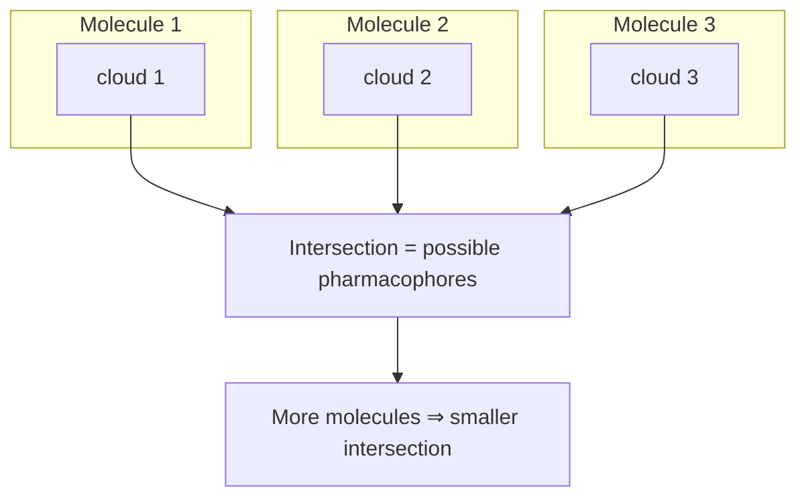

# Pharmacophore derivation

Given a set of molecules that bind the same protein — but **no** protein structure and no
known binding mode — infer the common [[concepts/pharmacophore]] they share.

## Why it matters

This is the ligand-only fallback. Lecture 4 defined the pharmacophore as the inferred
negative image of a binding site; here we actually have to compute it, and the only
evidence available is that all these molecules are active. The derived model then becomes
the query for [[concepts/pharmacophore-matching]], so every downstream hit depends on it.

## The screening workflow


*The pharmacophore is not derived once — hit lists of known actives and inactives feed back into model refinement, raising sensitivity and specificity.*

Each hit carries the molecule conformation that satisfied the model, so the analysis step
can ask "does this fit the pharmacophore or not?" for compounds whose activity is known.

## Mechanics

The general recipe is: **compute a multiple superposition of the actives, then extract the
groups that superimpose.** Two concrete strategies appear.

### a) Active-analog approach — via groups

Identify *essential groups*: groups that could form pharmacophore points at all
(donors, acceptors, charges, aromatic rings, lipophilic centres).

### b) Active-analog approach — via the distance pattern (orientation maps)

Instead of reasoning about groups directly, reason about the geometry they can realise.

```text
ALGORITHM OrientationMapIntersection
INPUT   actives M = {m_1..m_n}; k pharmacophore point types
OUTPUT  space of pharmacophore distance patterns consistent with all actives

FOR each molecule m IN M:
    map[m] := {}
    FOR each conformation c OF m:                    // conformation space
        FOR each choice of k potential pharmacophore points in c:
            v := (pairwise distances between the k points)   // a point in R^(k choose 2)
            map[m] := map[m] ∪ {v}
    // map[m] is a point cloud in "distance space"

RETURN  map[m_1] ∩ map[m_2] ∩ ... ∩ map[m_n]
```

Each molecule produces a **point cloud** in distance space, generated by two independent
variations: which atoms are taken as the potential pharmacophore points, and which
conformation the molecule adopts. A single point in the cloud — e.g. the triple
(dist(A,D), dist(D,H), dist(A,H)) for an acceptor A, donor D and hydrophobe H — *is* a
candidate pharmacophore.


*Every active constrains the distance space; the pharmacophore is what survives all of them.*

The key monotonicity: **the more molecules, the smaller the remaining space.** This is the
same "intersect the evidence" logic that makes [[concepts/frequent-pattern-mining]] work,
but in a continuous geometric space rather than a discrete lattice.

## Caveats

- The conformation space must be enumerated ([[concepts/conformation-generation]]), and the
  bioactive conformer is unknown — so the cloud is an over-approximation.
- Distances alone do not fix chirality; see the stereoisomer check in
  [[concepts/disco-algorithm]].
- If the actives are too similar the intersection stays large and the model is unselective;
  if they are too diverse it may be empty.

## See also

- [[concepts/pharmacophore]]
- [[concepts/disco-algorithm]]
- [[concepts/pharmacophore-matching]]
- [[concepts/molecular-superposition]]
- [[concepts/conformation-generation]]

## Sources

- [[sources/ciw-05-pharmacophores-qsar-and-docking]] (pp. 1–2)
