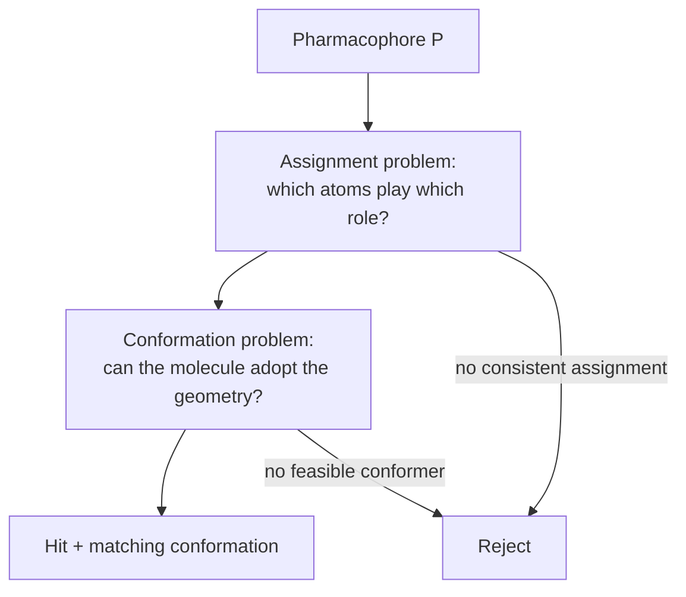

# Pharmacophore matching (3D database searching)

**Given** a pharmacophore P and a molecule database, **find** the molecules that satisfy P
together with the assignment of P's points to their atoms.

## Why it matters

This is the query side of the ligand-based pipeline: the model derived in
[[concepts/pharmacophore-derivation]] only pays off if it can be run against millions of
compounds. It is [[concepts/virtual-screening]] with a geometric, interpretable query
instead of a similarity score.

## The shared problem structure

Every system has to solve the same two nested problems at once:


*A hit is only a hit if some assignment of points and some conformation are simultaneously feasible — which is why the systems differ mainly in the order they attack these two.*

```text
ALGORITHM PharmacophoreSearch (generic)
INPUT   pharmacophore P with tolerances, molecule database DB
OUTPUT  hits, each with an assignment and a conformation

FOR each molecule m IN DB:
    FOR each assignment a OF P's points TO m's feature points:
        IF a is distance-compatible with P (within tolerance):
            FOR each conformation c OF m (enumerated or optimised):
                IF c realises a within tolerance:
                    REPORT (m, a, c); BREAK
```

The systems differ in *how* the two inner loops are made tractable.

| System | Conformations | Core technique | Page |
|---|---|---|---|
| [[concepts/catalyst-algorithm]] | pre-enumerated, hierarchical scan | backtracking atom-by-atom matching | 4 |
| [[concepts/caveat-algorithm]] | pre-enumerated, all vector pairs stored | binned index over vector-pair geometry | 5 |
| [[concepts/directed-tweak]] (UNITY) | **generated on demand** by optimisation | numerical torsion-angle optimisation | 6 |
| [[concepts/ligandscout-algorithm]] | — | maximum bipartite matching + Kabsch fit | 7 |
| [[concepts/pharmer-algorithm]] | pre-enumerated | KDB-tree index over point triangles | 7 |

The split is the familiar one: **precompute and index** (CAVEAT, Pharmer) versus
**search and optimise on the fly** (UNITY, LigandScout).

## Caveats

- Tolerances are doing enormous work: too tight and real actives are missed because the
  stored conformer is slightly off; too loose and the model stops discriminating.
- A hit list is not a ranking. The hit-list analysis step of
  [[concepts/pharmacophore-derivation]] and the metrics of
  [[concepts/enrichment-factor]] are what turn matches into a decision.

## See also

- [[concepts/pharmacophore]]
- [[concepts/pharmacophore-derivation]]
- [[concepts/virtual-screening]]
- [[concepts/conformation-generation]]

## Sources

- [[sources/ciw-05-pharmacophores-qsar-and-docking]] (pp. 4–7)
