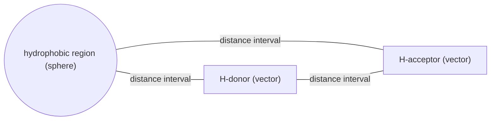

# Pharmacophore

The **arrangement of functional groups in space that is necessary in order to bind to a
particular protein.**

## Motivation for 3D descriptors

> What is relevant for binding is the **specific spatial arrangement of functional groups,
> not the scaffold that carries them** (Bindungsgerüst).

Two molecules with completely different skeletons can present the same donor, acceptor and
hydrophobic groups at the same relative positions, and will then bind the same target. A
topological descriptor ([[concepts/reduced-graphs]]) cannot see this; a 3D descriptor can.

⚠️ **Problem: the conformations of the molecules are unknown.** This single fact is
responsible for most of the difficulty (and most of the disappointing performance) of 3D
descriptors.

## Definition

A pharmacophore is the **ensemble of steric and electronic properties that is necessary to
guarantee an optimal supramolecular interaction with a specific biological target and to
trigger or to block its biological response.**

## Elements

| Element | Represents |
|---|---|
| **Vectors** | H-bond donor, H-bond acceptor (direction matters — see [[concepts/hydrogen-bond]]) |
| **Spheres** | hydrophobic region ([[concepts/hydrophobic-effect]]) |
| **Exclusion volumes** | space that must remain empty (occupied by the protein) |
| **Distance intervals** | connect the elements to one another |

*A pharmacophore is a small labelled graph of features connected by distance intervals — not a molecule.*

## Potential pharmacophoric points (PPP)

**PPPs** are points that are *potentially* involved in a pharmacophore — e.g. a positive
charge on an `H₃N⁺` group, a donor `NH`, an acceptor ring nitrogen. Enumerating PPPs turns
a molecule into a small set of typed points, which is the input to
[[concepts/atom-pair-and-triplet-descriptors]].

## Caveats

- A pharmacophore hypothesis is only as good as the conformations used to derive it.
- Exclusion volumes require knowledge of the protein; ligand-based pharmacophores usually
  lack them.

## See also

- [[concepts/atom-pair-and-triplet-descriptors]]
- [[concepts/ultrafast-shape-recognition]]
- [[concepts/molecular-superposition]]
- [[concepts/intermolecular-interactions]]
- [[concepts/virtual-screening]]

## Sources

- [[sources/ciw-04-descriptor-evaluation-clustering-and-superposition]] (p. 3)
