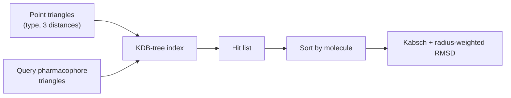

# Pharmer

An **index-based** method for finding pharmacophore-matching molecules in a database: all
triangles between pharmacophore points are stored in a spatial index (a KDB-tree) and the
query is answered by lookups rather than by search.

## Why it matters

Pharmer is the scaling answer. [[concepts/catalyst-algorithm]] and
[[concepts/directed-tweak]] do work *per molecule*; Pharmer does work *per query*, which is
what makes interactive screening of very large databases possible.

## Mechanics

```text
ALGORITHM PharmerBuild
FOR each molecule m (in each stored conformation):
    FOR each triple of pharmacophore points (p1,p2,p3) IN m:
        key := (types of p1,p2,p3 ; d(p1,p2), d(p1,p3), d(p2,p3))
        insert key INTO KDB-tree
        metadata := { layers, references, Cartesian coordinates,
                      molecule id, Bloom filter }

ALGORITHM PharmerSearch
INPUT   pharmacophore P
1. query the KDB-tree with ALL triangles of P
2. sort the resulting hit list by molecule
3. FOR each candidate molecule:
       compute the superposition (Kabsch)
       score with a RADIUS-WEIGHTED RMSD
```


*The triangle is the indexable unit: rigid, rotation-invariant and cheap to key on.*

The triangle is chosen for the same reason it is chosen in
[[concepts/atom-pair-and-triplet-descriptors]] and
[[concepts/geometric-hashing-docking]]: three points with their three distances fix a rigid
body up to reflection, so the key is invariant under the pose we have not yet determined.

The final score is a **radius-weighted RMSD** — pharmacophore points with a large tolerance
radius are permitted larger deviations, so the spatial tolerance of the model is carried
into the ranking rather than applied as a hard cut-off.

## Caveats

- Index size grows as O(k³) in the number of pharmacophore points per conformer, times the
  number of conformers.
- What the stored Bloom filter tests is not stated in the notes → [[open-questions]].
- The index is over pre-generated conformers, so it inherits every limitation of
  [[concepts/conformation-generation]].

## See also

- [[concepts/pharmacophore-matching]]
- [[concepts/geometric-hashing-docking]]
- [[concepts/rmsd-and-point-set-superposition]]
- [[concepts/caveat-algorithm]]

## Sources

- [[sources/ciw-05-pharmacophores-qsar-and-docking]] (p. 7)
