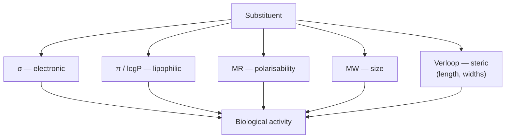

# Physico-chemical parameters

The classical descriptors of [[concepts/qsar]]: measurable molecular properties chosen
because they are relevant for biological activity.

## Why it matters

These five parameter families are the vocabulary of Hansch-type models. Each one is a
proxy for a different physical contribution to binding identified in lecture 1, which makes
them interpretable in a way that a fingerprint bit never is.

## The parameters

| Parameter | Symbol | Describes | Lecture-1 counterpart |
|---|---|---|---|
| Hammett constants | σ | electronic properties, e.g. the ability to form hydrogen bonds | [[concepts/hydrogen-bond]] |
| Lipophilicity parameters | π / logP | solubility in a hydrophobic environment | [[concepts/hydrophobic-effect]] |
| Molar refraction | MR | polarisability | dispersion / [[concepts/intermolecular-interactions]] |
| Molecular weight | MW | size of the molecule | [[concepts/admet]] boundary conditions |
| Verloop parameters | — | steric parameters: length and widths of substituents | shape complementarity |


*Each parameter isolates one physical axis, so a regression coefficient can be read as "how much does this effect matter here?".*

```text
// typical use inside a Hansch model
log 1/C  =  k1 · (logP)^2  +  k2 · logP  +  k3 · σ  +  k4 · MR  +  ...  +  k
              ^ lipophilicity, non-linear   ^ electronics  ^ polarisability
```

The Verloop parameters are multi-dimensional on purpose: a substituent has a length and
*several* widths, because steric fit in a binding pocket is directional.

## Caveats

- σ and π are **substituent** constants, measured on model systems and transferred; the
  transfer assumes the rest of the molecule does not interfere.
- MW is a very coarse descriptor — it correlates with almost everything, which makes it a
  frequent source of spurious fits.
- The parameters are correlated with each other (larger substituents are usually more
  lipophilic), which destabilises the regression and motivates
  [[concepts/principal-component-analysis]].

## See also

- [[concepts/lipophilicity-and-logp]]
- [[concepts/hansch-analysis]]
- [[concepts/qsar]]
- [[concepts/admet]]

## Sources

- [[sources/ciw-05-pharmacophores-qsar-and-docking]] (p. 15)
