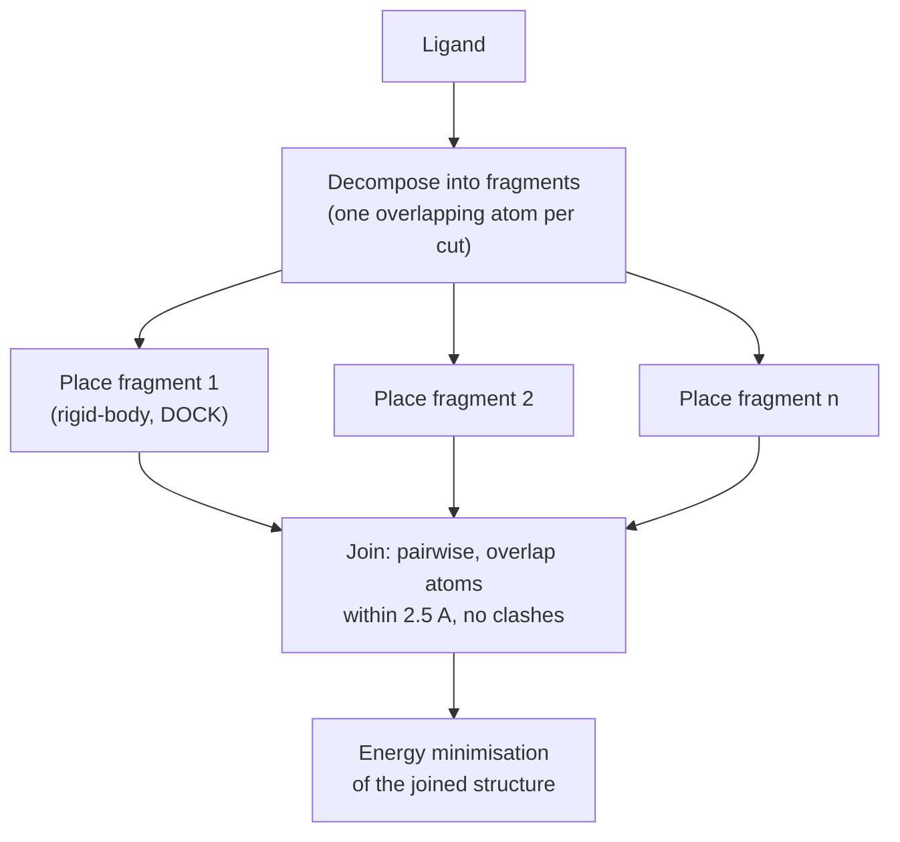

# Place and join docking

A combinatorial [[concepts/flexible-docking|flexible docking]] strategy: decompose the
ligand into fragments, dock each fragment **independently** into the active site, then join
the compatible placements back together.

## Why it matters

Each fragment is small and nearly rigid, so it can be docked exhaustively by a rigid-body
method. Flexibility is recovered in the *joining* step, which only has to check whether
independently found placements happen to be geometrically compatible.


*Fragments are docked independently and only afterwards tested for mutual compatibility.*

## DesJarlais

```text
ALGORITHM DesJarlais
  manual fragmentation of the ligand,
      with ONE OVERLAPPING ATOM per cut site
  docking of the fragments with the DOCK algorithm
  JOINING: a sequence of pair-joining steps
      in arbitrary or fixed order
  FOR each fragment pair (i, i+1):
      determine placement pairs such that
          distance of the overlap atoms ≤ 2.5 Å
          and the fragments do not overlap
  energy minimisation of the generated structure
```

The overlapping atom is the trick: because neighbouring fragments share an atom, "can these
two placements be joined?" reduces to "do the two copies of the shared atom land close
enough together?"

## Hinge bending

```text
HINGE BENDING
  fragments as above, plus HINGE = the shared atom
  extension of the geometric-hashing approach
  hinge = a flexible 'ball joint' in the molecule (ligand or protein)
          → also models domain movement in proteins

  HASH TABLE for the ligand set:
      key   : ligand atom triplets, distances → hash address
      value : ligand, hinge position

  MATCHING:
      FOR each receptor triplet:
          search matching ligand triplets in the hash table
          VOTE for the hinge position
          store (ligand, fragment, transformation) with the hinge position

  VERIFICATION:
      FOR each hinge with a high vote count:
          select collision-free ligand-fragment placements
          join and score
```

Hinge bending generalises [[concepts/geometric-hashing-docking]] by voting for a *hinge
position* rather than for a whole ligand. Because a hinge can just as well sit in the
protein, the same machinery covers domain motion — the one place in the lecture where
[[concepts/protein-flexibility]] is handled explicitly rather than ignored.

## Caveats

- DesJarlais requires **manual** fragmentation — not automatable as stated.
- Pairwise joining in a fixed order can miss solutions that require simultaneous compromise
  across three or more fragments.
- The 2.5 Å overlap tolerance is generous; a joined structure always needs minimisation
  afterwards and may not survive it.

## See also

- [[concepts/flexible-docking]]
- [[concepts/incremental-construction-docking]]
- [[concepts/dock-algorithm]]
- [[concepts/geometric-hashing-docking]]
- [[concepts/protein-flexibility]]

## Sources

- [[sources/ciw-06-flexible-docking-binding-sites-and-fragment-spaces]] (p. 6)
