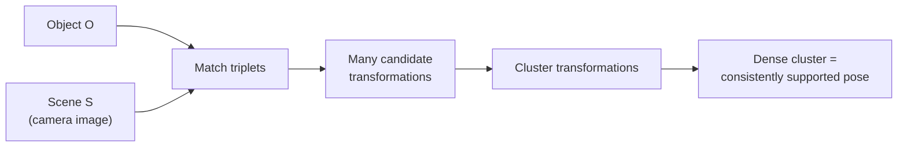

# Pose clustering

A docking method (Rarey, used in FlexX) borrowed from pattern recognition: generate very
many candidate ligand orientations from interaction triplets, then **cluster the
orientations themselves** to find the ones supported by independent evidence.

## Why it matters

Pose clustering answers the question "many very similar orientations — which are similar to
each other?" It is the docking analogue of the voting scheme in
[[concepts/geometric-hashing-docking]], but instead of voting for a ligand it votes for a
*transformation*.

The pattern-recognition origin is explicit: the classical task is to find an object O in a
camera scene S by assigning a subset S′ of the scene points to O.


*A pose supported by several independent triplet matches shows up as a cluster in transformation space.*

## Protein representation

```text
→ description of interaction groups and counter-groups by PARTIAL SPHERICAL SURFACES:
      interaction surface  and  interaction centre

→ an interaction OCCURS when:
      the interaction centre of A lies on the interaction surface of B
      and vice versa

→ discretisation of the interaction surfaces by INTERACTION POINTS
```

So a hydrogen bond, for instance, becomes a pair of cones/spherical caps: the donor's
centre must fall inside the acceptor's surface and conversely. This is a geometric
re-encoding of the H-bond geometry criteria from [[concepts/hydrogen-bond]].

## Hash table and initial orientations

```text
BUILD: a hash table for EACH interaction-type pair (a,b)
    store interaction point pairs (p,q) under the address d(p,q)

SEARCH INITIAL LIGAND ORIENTATION:
FOR each triplet of interaction centres (a,b,c) IN the ligand:
    generate a list of type-compatible, distance-compatible
        interaction point pairs for (a,b) and for (a,c)
    build all distance-compatible triangles (p,q,r) by LIST MERGING
        (then also test (b,c))
    FOR each triangle (p,q,r):
        generate the ligand transformation
        overlap test
```

## Clustering the orientations

```text
→ complete-linkage clustering with a BOUNDED CLUSTER DIAMETER d_max
→ distance measure: RMSD of the atom coordinates

   d_rms( (R1,t1), (R2,t2) ) = sqrt( (1/n) Σ_i ( (R1·x_i + t1) − (R2·x_i + t2) )² )
```

```text
RUNTIME
  - d_rms can be evaluated in O(1) after O(n) preprocessing
  - let m = # orientation pairs A,B with d_rms(A,B) ≤ d_max, then:
        scoring all pairs .................... O(n²)
        sorting the list of all pairs ........ O(m log m)
        running complete linkage with the list O(m)

→ then: extension of the matchings, overlap test, scoring
```

Two points deserve attention. First, the distance is defined **between transformations**,
not between structures, but is measured in atom-coordinate space — it asks "how far apart
would this ligand's atoms be under these two poses?", which is the physically meaningful
question. Second, complete linkage with a hard diameter bound is chosen so that every
cluster is guaranteed compact; see [[concepts/hierarchical-clustering]].

The payoff is stated plainly in the notes: *then find orientations with more than three
superpositions* — i.e. poses independently confirmed by more triplet matches than the
minimum needed to define them.

## Caveats

- O(n²) pair scoring bounds the number of candidate orientations that can be handled.
- d_max is a free parameter: too large merges distinct binding modes, too small fragments
  one mode into several clusters.
- Still rigid-body per conformer.

## See also

- [[concepts/docking]]
- [[concepts/geometric-hashing-docking]]
- [[concepts/hierarchical-clustering]]
- [[concepts/rmsd-and-point-set-superposition]]
- [[concepts/incremental-construction-docking]]

## Sources

- [[sources/ciw-06-flexible-docking-binding-sites-and-fragment-spaces]] (pp. 1–2)
