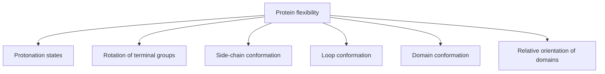

# Protein Flexibility

Proteins are **not rigid objects** — modelling their flexibility is named in lecture 1 as
*the* challenge of computer-aided drug design.

## Degrees of freedom, ordered by scale


*Six levels of flexibility, from sub-atomic charge placement to whole-domain motion.*

Protein flexibility takes place on **different timescales**, which is why a single static
crystal structure is an incomplete model.

```text
ALGORITHM FlexibilityAwareDocking(ligand L, protein P)
  INPUT : ligand, protein with flexible regions
  OUTPUT: pose and score

  ensemble <- generateProteinStates(P)      # protonation, side chains, loops
  best <- none
  for each state p in ensemble:
      for each conformer c of L:
          pose  <- dock(c, p)
          score <- scoringFunction(pose) − strainPenalty(c) − statePenalty(p)
          best  <- argmax(best, score)
  return best
  # cost multiplies: |ensemble| × |conformers| × pose search
```

## Computer applications in drug design (context)

- Pre-selection of substances for screening (similarity, diversity)
- Databases for molecule management
- Computer-based modelling (visualisation, modelling)
- Prediction of protein–ligand complexes, ligand–ligand superposition
- Computation of quantitative structure–activity relationships (**QSAR**)
- Computation of physico-chemical properties
- Prediction of **ADMET** properties
- Energy minimisation, molecular dynamics calculations

## See also

- [[concepts/protein-ligand-binding]]
- [[concepts/virtual-screening]]
- [[concepts/molecular-structure-and-stereochemistry]]
- [[concepts/drug-discovery-pipeline]]

## Sources

- [[sources/ciw-01-drug-action-and-molecular-interactions]] (p. 20)
