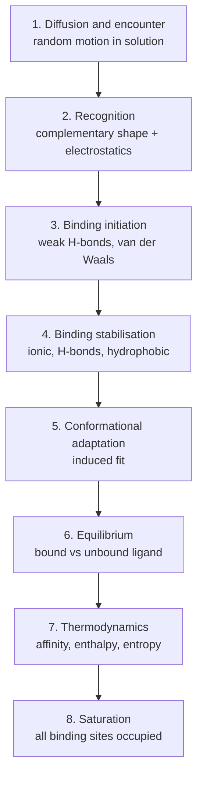

# Protein–Ligand Binding

The specific, reversible association of a small molecule with a protein, driven by
complementary shape and physico-chemical properties.

## Why it matters

Complex formation is the molecular event that a drug is designed to cause (or prevent).
Docking, scoring and structure-based design all try to reproduce this process in silico.

## Foundations

- **Intermolecular interactions** are the fundamental property on which all life processes
  are based: metabolism and information processing.
- **Complex formation** — specific attachment of one molecule to another.
  - necessary for a process to take place (conversion of a substance)
  - energetically favourable
  - **reversible**: after the process the molecules separate again
  - **complementarity**: steric (spatial) *and* physico-chemical → lock-and-key principle
- Binding is based on reversible, weak, short-range interactions.
- Ligand and protein are both **flexible**.
- Estimating the energy is a hard problem (influence of the solvent, electrostatics, entropy).

## The binding process, stage by stage


*Eight stages of protein–ligand complex formation, as given in lecture 1.*

```text
ALGORITHM BindingProcess(ligand L, protein P, solvent W)
  INPUT : L and P freely diffusing in W
  OUTPUT: complex L·P at equilibrium

  1  diffuse(L, P)                      # random motion until encounter
  2  if complementary(shape(L), shape(P)) and complementary(charges): 
  3      form weak contacts              # H-bonds, van der Waals
  4      strengthen contacts             # ionic, H-bonds, hydrophobic
  5      L, P <- inducedFit(L, P)        # mutual conformational adaptation
  6  equilibrium: [L][P] / [L·P] = Ki    # see binding-thermodynamics
  7  ΔG = ΔH − T·ΔS
  8  if [L] >> Ki: all sites saturated
```

## Contribution of the solvent

Water is never a passive background — see [[concepts/desolvation-and-water]].

## GCI similarity-search framing

GCI part 4 revisits binding to motivate [[concepts/molecular-similarity]]: if the exact protein structure or binding mode is unknown, ligands are compared statistically by properties that are expected to preserve the relevant [[concepts/intermolecular-interactions]]. The notes emphasise that both ligand and protein are flexible and that small changes can still strongly affect affinity.

```text
PROCEDURE LigandBasedBindingHypothesis(knownLigand L, candidate C)
  INPUT : known binder L and candidate molecule C
  OUTPUT: qualitative binding hypothesis

  compare spatially relevant functional groups and physico-chemical properties
  if C preserves enough binding-relevant features:
      predict similar binding behaviour statistically
  else:
      reject as unsupported by the similarity principle
```

## See also

- [[concepts/intermolecular-interactions]]
- [[concepts/binding-thermodynamics]]
- [[concepts/desolvation-and-water]]
- [[concepts/protein-flexibility]]
- [[concepts/enzymes-and-receptors]]

## Sources

- [[sources/ciw-01-drug-action-and-molecular-interactions]] (pp. 5–6)
- [[sources/gci-04-molecular-glues-descriptors-fingerprints-and-similarity]] (pp. 1-2)
