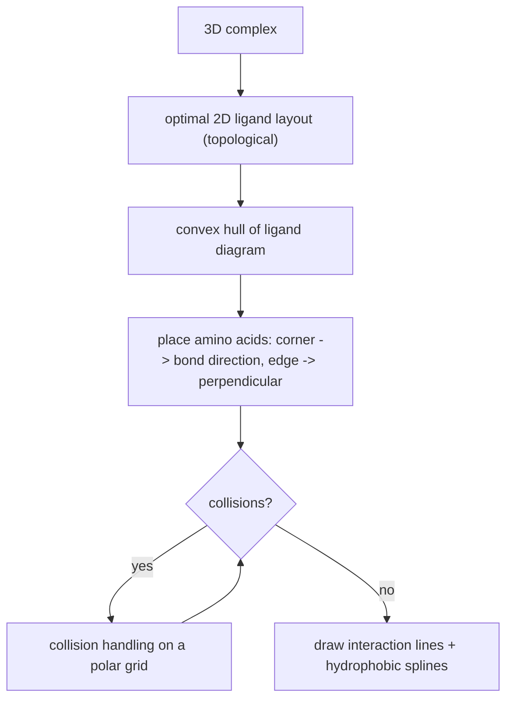

# 2D Protein–Ligand Interaction Diagrams

Extending [[concepts/structure-diagram-generation]] from a lone molecule to a **binding
site**: the ligand is drawn in 2D, the contacting amino acids are placed around it, and the
[[concepts/intermolecular-interactions]] are drawn as lines between them.

## Why it matters

A 3D complex is hard to read and impossible to put in a table. A 2D interaction diagram
compresses a docking pose or crystal structure into a picture that immediately shows *which*
residue makes *which* interaction — the visual summary of
[[concepts/protein-ligand-binding]].

## Optimal ligand layout

**Goal:** find a two-dimensional conformation of the ligand that permits a
**crossing-free arrangement of the interaction lines.**

- **Topological method.**
- Possible operations for influencing the conformation:
  - flipping bonds
  - exchanging bonds that emanate from the same atom
- Chemical rules must be respected, e.g. *cis*/*trans* rules or the correct arrangement of
  stereocentres ([[concepts/molecular-structure-and-stereochemistry]]).

This is a second NP-hard layout problem stacked on top of SDG: the objective is no longer
"few crossings among bonds" but "no crossings among interaction lines".

## Initial amino-acid placement

- **Geometric method.**
- Based on the **convex hull** of the ligand diagram:
  - **corner** of the hull → continuation of the bond direction
  - **edge** of the hull → perpendicular to the adjacent polygon edge
- Amino acids are placed **independently of one another**.
- ⚠️ Therefore **collisions between individual elements are possible**.

*Three stages: lay out the ligand, place residues from the convex hull, then repair collisions.*

## Collision handling

- Search for an **optimal relative arrangement of all diagram elements**.
- Enumeration of the amino-acid positions on a **polar grid**.
- Collision types:
  - overlap of structure diagrams
  - crossing of interaction lines
  - intersections between interaction lines and diagrams

## Hydrophobic contacts

Amino acids making **hydrophobic contacts** ([[concepts/hydrophobic-effect]]) are not drawn
as full structure diagrams:

- contact surfaces of the ligand are symbolised by **sections of a cubic spline** around the
  ligand
- **support points** of the cubic spline: the coordinates of the apolar heavy atoms, moved
  outward by a standard bond length
- placement with the help of a **grid**

## See also

- [[concepts/structure-diagram-generation]]
- [[concepts/collision-detection-scan-line]]
- [[concepts/intermolecular-interactions]]
- [[concepts/protein-ligand-binding]]
- [[concepts/hydrophobic-effect]]

## Sources

- [[sources/ciw-03-pattern-mining-diagrams-surfaces-and-reduced-graphs]] (pp. 12–13)
