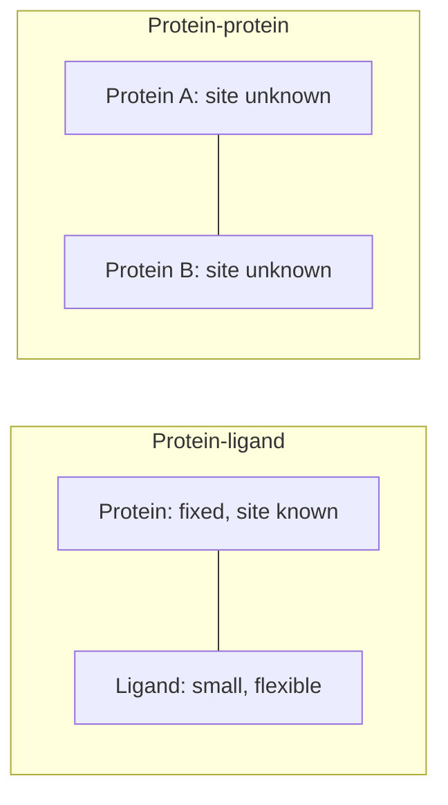
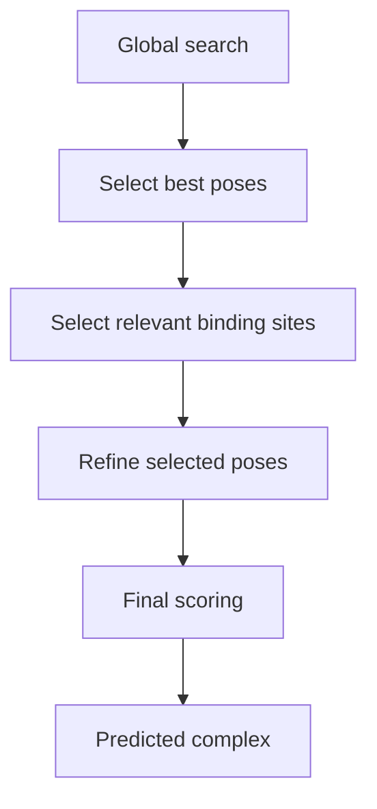

# Protein–protein docking

Given two proteins, find the relative orientation in which they bind.

## Why it matters

```text
SIGNIFICANCE
  protein complexes play a central role in organisms:
      functional units (ion channels, chaperones)
      information exchange
      antibodies
```

**Protein interaction networks**: nodes = protein complexes, edges = shared proteins. The
complexes, not the individual chains, are the functional units — so understanding function
means understanding interfaces.

## Differences to protein–ligand docking

```text
- the problem is SYMMETRIC
- the CONTACT SITE IS UNKNOWN (on both partners)
- LARGE contact surface
- differences in the treatment of flexibility;
  the global conformation of the proteins is constant
- binding-decisive HOT-SPOT amino acids
- chemical groups restricted to those of amino acids
- quasi NO SCREENING application
```


*Protein–ligand docking is asymmetric with a known pocket; protein–protein docking is symmetric with two unknown, large, flat interfaces.*

The consequences are severe. In [[concepts/docking]] the pocket confines the search to a
small box; here neither partner offers a box, so the search is **global** over all relative
rotations and translations. On the other hand the chemistry is simpler — only 20 amino-acid
side chains occur — and since there is no screening application, one may spend far more
compute per complex.

"Global conformation constant" is the standard simplification: backbone rigid, flexibility
limited to side chains (see [[concepts/protein-flexibility]]).

**Hot spots**: a large interface does not contribute affinity uniformly; a small set of
residues carries most of the binding energy.

## The pipeline

```text
ALGORITHM ProteinProteinDocking
    GLOBAL SEARCH over relative orientations
        ↓
    selection of the best poses
        ↓
    selection of the relevant binding sites
        ↓
    REFINEMENT of the selected poses
        ↓
    FINAL SCORING
        ↓
    result
```


*The same funnel as GLIDE, but starting from an exhaustive global search rather than a known pocket.*

## Classes of algorithm

```text
KIND OF GLOBAL SEARCH
    → Fourier-transformation-based methods   (Katchalski-Katzir)
    → geometric methods                      (PatchDock)
    → simulation-based methods               (RosettaDock, ICM-DISCO)

FLEXIBILITY / SCORING
    → surface complementarity / soft docking
    → force-field potentials / simplified models
    → force-field potentials / side-chain optimisation
```

Note the pairing: the cruder the search, the cruder the scoring it can afford, and vice
versa. See [[concepts/katchalski-katzir-algorithm]],
[[concepts/surface-reduction-for-docking]] and
[[concepts/monte-carlo-protein-docking]].

## Evaluation: CAPRI

```text
CAPRI:  ~50 % success rate

GOOD           : enzyme–inhibitor complexes
VERY DIFFICULT : small-signal complexes,
                 transient complexes,
                 antigen–antibody complexes
```

The pattern is informative. Enzyme–inhibitor complexes are tight, rigid and shape
complementary — exactly the assumptions the algorithms make. Transient and antibody
complexes involve conformational change on binding, which the rigid-backbone assumption
forbids.

## Caveats

- ~50 % success means a prediction is barely better than a coin flip without experimental
  corroboration.
- Rigid-backbone docking fails precisely for the biologically most interesting (transient,
  signalling) complexes.
- Scoring large flat interfaces is harder than scoring pockets: there is no enclosure to
  reward.

## See also

- [[concepts/katchalski-katzir-algorithm]]
- [[concepts/surface-reduction-for-docking]]
- [[concepts/monte-carlo-protein-docking]]
- [[concepts/docking]]
- [[concepts/protein-flexibility]]
- [[concepts/molecular-surfaces]]

## Sources

- [[sources/ciw-06-flexible-docking-binding-sites-and-fragment-spaces]] (pp. 24–25, 28)
