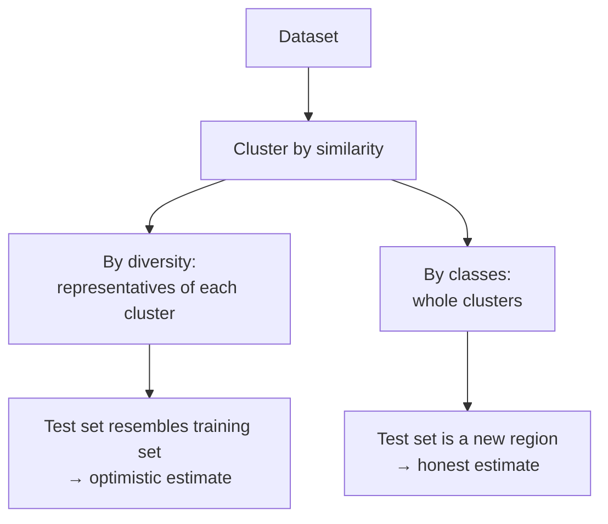
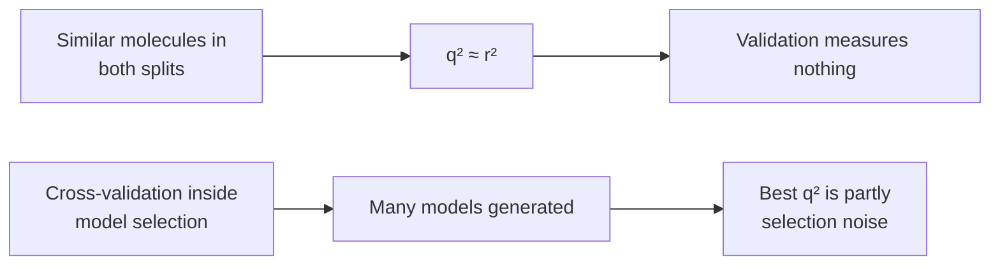

# QSAR model validation

How to decide whether a QSAR model is any good — where **good** means *correct prediction
for unknown molecules*, not *good fit to the data it was built on*.

## Why it matters

This is the counterpart of [[concepts/roc-curves-and-auc]] for regression models, and the
lecture treats it with the same suspicion: every metric here can be made to look good by a
model that has learned nothing generalisable.

## Splitting the data

```text
"GOOD MODEL" := correct prediction for unknown molecules

→ split the data into TEST set (check quality) and TRAINING set (derive the model)

→ 'LEAVE n OUT CROSS VALIDATION':
      take n data points into the test set, the rest into the training set
      repeat model generation / test for ALL sets of n data points
      (n = 1 gives leave-one-out, LOO)

→ SEPARATION OF A TEST SET BEFORE deriving the model:
      cluster the molecules by similarity, then
        by DIVERSITY : take some representatives of each cluster
        by CLASSES   : take whole clusters
```


*How you split decides what question the validation answers: interpolation, or extrapolation to a new chemical class?*

The clustering here is the one from [[concepts/clustering-of-molecules]] — validation reuses
the descriptor machinery it is meant to judge.

## Metrics: fit to the training set

Let y₁…y_n be the measured values with mean ȳ, and p₁…p_n the values predicted by the model
with mean p̄.

```text
RSS = SSE = Σ_i (y_i − p_i)²        // residual sum of squares = sum of squared errors
MSE       = (1/n) Σ_i (y_i − p_i)²  // mean squared error
RMSE      = sqrt( (1/n) Σ_i (y_i − p_i)² )   // root MSE

value range 0 … ∞ ,  0 = identical
```

> A low RSS value shows that the data **can be described** by the QSAR model.
> **NOT**: that it can predict unknown molecules with high accuracy.

## Metrics: correlation

```text
(Pearson) correlation coefficient r, also coefficient of determination r²:

              Σ_i (p_i − p̄)(y_i − ȳ)
  r  =  ───────────────────────────────────────
        sqrt(Σ_i (p_i − p̄)²) · sqrt(Σ_i (y_i − ȳ)²)

  r ∈ [−1, 1]        −1 = anticorrelated, +1 = correlated
  r ∈ [ 0, 1]        correlated

R² value (normalised squared error):

               Σ_i (p_i − y_i)²
  R²  =  1 − ───────────────────        R² ∈ (−∞, +1] ,  1 = identical
               Σ_i (y_i − ȳ)²
```

r and R² are **not** the same thing: r ignores systematic offset and scaling (a model that
predicts every value twice too large still has r = 1), while R² also considers the residual
errors and can go arbitrarily negative.

## From r², R² to q², Q²

```text
"How well does the model approximate the TEST set?"

→ the functions for r², R² can also be applied to the test set,
  or inside the cross-validation
        →  q² ,  Q²
```

| Metric | Computed on |
|---|---|
| r², R² | training set |
| q², Q² (LOO q²) | cross-validation |
| external q² | an independent dataset not used during training |

Reading the numbers (from exercise 6-1):

| LOO q² | external q² | verdict |
|---|---|---|
| high | high | model is good and reliable for new data |
| high | low | **overfitting** the training data |
| low | low | bad |

and `q² > 0` = good, `q² = 0` = not better than random.

## The two pitfalls

```text
PROBLEMS:

→ If very similar molecules are in the test AND training set, then
  q², Q² are very similar to r², R²  — the test molecules are not
  really unknown molecules.

→ To evaluate the q² value with cross-validation, NOT ONE model but
  VERY MANY models are generated.
```


*Both pitfalls inflate q²; neither is visible from the reported number alone.*

The second is the subtler one and applies directly to
[[concepts/partial-least-squares]], whose component count is chosen *by* cross-validated q².
Selecting a model on a statistic and then reporting that statistic as validation is circular.

## Caveats

- None of these metrics detects that the model is extrapolating outside its applicability
  domain; the diversity/class splitting is the only defence offered.
- The metrics assume the measured activities are themselves accurate; experimental error
  sets a ceiling on any achievable R².

## See also

- [[concepts/qsar]]
- [[concepts/partial-least-squares]]
- [[concepts/roc-curves-and-auc]]
- [[concepts/clustering-of-molecules]]
- [[exercises/ciw-e6-qsar-and-matched-molecular-pairs]]

## Sources

- [[sources/ciw-05-pharmacophores-qsar-and-docking]] (pp. 13–14, 23–24)
