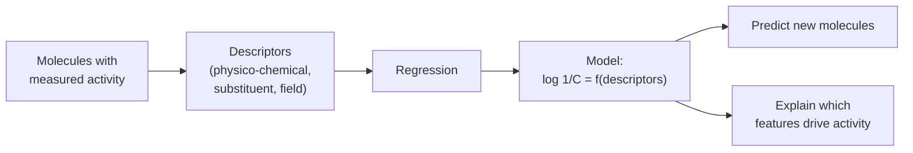
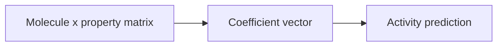

# QSAR

**Quantitative structure–activity relationships**: the capture and quantitative description
of the relationship between chemical structure and biological effect.

## Why it matters

QSAR is the oldest computational drug-design method and still the template for all of them:
describe molecules numerically, regress against measured activity, use the model to
prioritise what to synthesise next. It is also where
[[concepts/scoring-functions]] come from — an empirical scoring function is a QSAR model
whose descriptors are the geometric features of a protein–ligand complex.

## Setup

| | |
|---|---|
| **Input** | a list of molecules with measured activity |
| **Goal 1** | prediction of biological activities of molecules |
| **Goal 2** | derivation of models to *explain* biological activity |
| **Method** | description of molecular properties; search for correlations with the measured activities |

The two goals pull in different directions, and the lecture keeps them apart throughout:
a model can fit well (explain) and predict badly, which is the entire subject of
[[concepts/qsar-model-validation]].


*One pipeline, two deliverables — prediction and explanation — which are validated differently.*

## The family of models

The lecture presents the methods as an increasingly general sequence:

```text
Hansch         log 1/C = k1(logP)^2 + k2 logP + k3 σ + ... + k
                 descriptors = global physico-chemical parameters

Free-Wilson    log 1/c = Σ_i Σ_j a_ij δ_ij + μ
                 descriptors = substituent indicator variables

Combined       log 1/c = Σ_i Σ_j s_ij Σ_k a_ijk Φ_ijk + μ
                 Free-Wilson is  k = 1, Φ_ijk = 1
                 Hansch      is  i = j = 1

3D-QSAR        log 1/C = Σ_fields Σ_grid a_{f,x,y,z} f(x,y,z) + a
                 descriptors = interaction fields sampled on a grid
```

The dependent variable throughout is **log 1/C**, where C is the *equi-effective molar
dose* — the concentration of the compound needed to achieve the same biological effect.
Using a log of a reciprocal concentration makes the target roughly linear in free energy,
which is why additive descriptor models work at all
(cf. [[concepts/binding-thermodynamics]]).

## Historical GCI framing

GCI highlights a 1962 QSAR study as the start of the matrix view: molecules are described by property columns, multiplied by fitted coefficients and mapped to biological activity.

```text
MODEL MatrixQSAR(X, beta)
  INPUT : molecule-by-property matrix X and coefficient vector beta
  OUTPUT: predicted activity vector y_hat

  y_hat <- X * beta
  compare y_hat with measured activity
  update beta or descriptor set if prediction is poor
```


*The foundation lecture presents QSAR as a linear structure-property mapping.*

Source: [[sources/gci-01-foundations-of-cheminformatics]] (p. 2).

## Caveats

- QSAR is correlational. A significant coefficient does not establish a mechanism.
- The models are only valid inside the chemical space of the training set; see the
  pitfalls in [[concepts/qsar-model-validation]].
- Additivity of contributions is an assumption — the same assumption that lecture 1 showed
  fails for binding free energies.

## See also

- [[concepts/hansch-analysis]]
- [[concepts/free-wilson-analysis]]
- [[concepts/3d-qsar]]
- [[concepts/qsar-model-validation]]
- [[concepts/physicochemical-parameters]]
- [[concepts/matched-molecular-pairs]]

## Sources

- [[sources/ciw-05-pharmacophores-qsar-and-docking]] (pp. 8, 15, 18)
