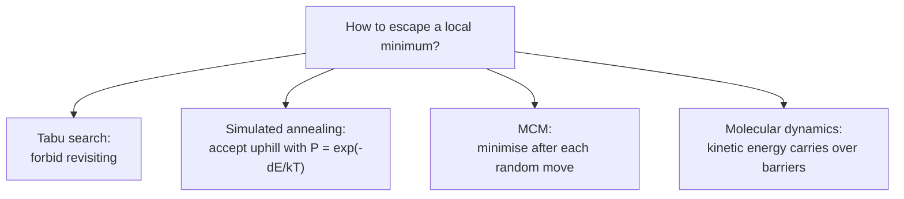

# Randomised docking methods

Stochastic local-search methods that start from a random pose and repeatedly apply random
local changes, accepting or rejecting them by a rule that tolerates temporary worsening.

## Why it matters

Pure hill climbing on a docking energy surface gets stuck immediately: the surface is
rugged, with deep narrow minima separated by steric barriers. Every method here is a
different answer to the same question — *how do you escape a local minimum?*


*Four escape mechanisms: memory, temperature, minimisation, and momentum.*

## PRO_LEADS — tabu search

```text
TABU SEARCH
  random generation of a start orientation
  ITERATE:
      generate random local changes
      select the energetically most favourable one that is NOT 'taboo'
      insert it into the tabu list
      store the best solution found so far
  → the same solution is never visited twice
```

The escape mechanism is **memory**: a short-term prohibition list forces the search out of a
basin it has already explored.

## AutoDock — simulated annealing

```text
SIMULATED ANNEALING
  random start orientation
  ITERATE:
      random local change
      accept with probability   P(ΔE) = exp( −ΔE / (k_B · T) )
  temperature schedule: T runs from a start value down to 0
```

The escape mechanism is **temperature**: early on, uphill moves are cheap, so the search
roams; as T → 0 acceptance of uphill moves vanishes and the method freezes into a minimum.
Note that `ΔE < 0` gives `P > 1`, i.e. downhill moves are always accepted.

## Monte Carlo + energy minimisation (MCM)

```text
MCM
  random local change (RANDOM MOVE)
  followed by ENERGY MINIMISATION
  → moves are guided along energetically favourable paths
    (analysis of the principal directions of motion)
```

The escape mechanism is **minimisation**: the random move only has to land in the *basin* of
a new minimum, not at the minimum itself, which makes the effective step size much larger.

## Molecular dynamics

```text
MD simulation of the ligand–protein complexes
```

The escape mechanism is **kinetic energy**: an integrated trajectory carries the system over
barriers it could not cross by construction. The most physical method, and by far the most
expensive.

## Comparison

| Method | Escape mechanism | Tuning parameter |
|---|---|---|
| tabu search | memory (tabu list) | list length, move set |
| simulated annealing | temperature | cooling schedule |
| MCM | post-move minimisation | move size, minimiser |
| MD | kinetic energy | time step, temperature, length |

## Caveats

- None of these is complete: failing to find a pose is not evidence that none exists.
- Results are run-dependent; multiple independent runs plus
  [[concepts/pose-clustering|clustering of the results]] are standard.
- All are only as good as the energy function they descend on — see
  [[concepts/scoring-functions]] and [[concepts/lennard-jones-potential]].

## See also

- [[concepts/flexible-docking]]
- [[concepts/genetic-algorithm-docking]]
- [[concepts/docking]]
- [[concepts/monte-carlo-protein-docking]]

## Sources

- [[sources/ciw-06-flexible-docking-binding-sites-and-fragment-spaces]] (p. 5)
