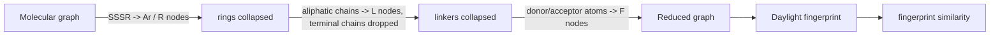

# Reduced Graphs

A molecular representation in which whole groups of covalently bonded atoms — rings,
linkers, functional features — collapse into **single labelled nodes**, giving a graph of
much lower complexity.

## Why it matters

The molecular graph as a descriptor is **precise**, *but*: it is a pure abstraction and is
**hard to compare** ([[concepts/subgraph-isomorphism]] is NP-complete). Reduced graphs trade
precision for comparability.

| | Molecular graph | Reduced graph |
|---|---|---|
| Precision | exact | abstracted |
| Comparison | NP-complete subgraph isomorphism | potentially simple / efficient |
| Node | one atom | a group of covalently bonded atoms |
| Edge | one bond | connects nodes of which at least two atoms are bonded |

Reduced graphs exist as **Markush structures** — the generic scaffold-plus-variable-group
notation used in patents.

## Generation

```text
ALGORITHM BuildReducedGraph(molecule)
  1. determine the SSSR; every SSSR ring becomes a node
        node type Ar : aromatic ring
        node type R  : any other ring
  2. determine all connected aliphatic carbon chains
        terminal chains are removed
        node type L  : linker
  3. determine the atoms with donor / acceptor functionalities
        node type F  : feature
```


*The reduction pipeline, and the route from a reduced graph to a comparable fingerprint.*

The pipeline reuses [[concepts/sssr-and-minimal-cycle-basis]] for step 1 and the
linker/chain distinction of [[concepts/linkers-and-chains]] for step 2 — lecture 2's ring
machinery is the precondition for lecture 3's descriptors.

## Gillet's hierarchy of node labels

Node labels can be chosen at four levels of abstraction (increasing detail downward):

| Level | Labels |
|---|---|
| 1 | Ring / Linker / Feature |
| 2 | Aromatic ring / Aliphatic ring / Linker / Feature |
| 3 | Non-hydrogen-bonding aromatic / Hydrogen-bonding aromatic / Aliphatic ring / Linker / Feature |
| 4 | Non-hydrogen-bonding aromatic / Aromatic ring with acceptor / Aromatic ring with donor / Aromatic ring with acceptor & donor / Linker / Donor feature / Acceptor feature / Donor & acceptor feature |

Level 1 is the most abstract (most molecules look alike); level 4 discriminates most but
generalises least — the usual resolution-versus-recall trade-off in descriptor design.

## Comparison

```text
Mol graph  ->  Reduced graph  ->  Daylight fingerprint  ->  fingerprint similarity
```

Converting the reduced graph into a **Daylight fingerprint** turns graph comparison into
bit-vector comparison, which is the whole point of the reduction.

## Caveats

- Because the reduction is based on the SSSR, it inherits the SSSR's **non-uniqueness**
  ([[concepts/sssr-and-minimal-cycle-basis]]) — two runs on the same molecule can in
  principle give different reduced graphs.
- Terminal chains are discarded, so substituent length is invisible at this level.

## See also

- [[concepts/feature-trees]]
- [[concepts/sssr-and-minimal-cycle-basis]]
- [[concepts/linkers-and-chains]]
- [[concepts/subgraph-isomorphism]]
- [[concepts/virtual-screening]]

## Sources

- [[sources/ciw-03-pattern-mining-diagrams-surfaces-and-reduced-graphs]] (pp. 20–21)
