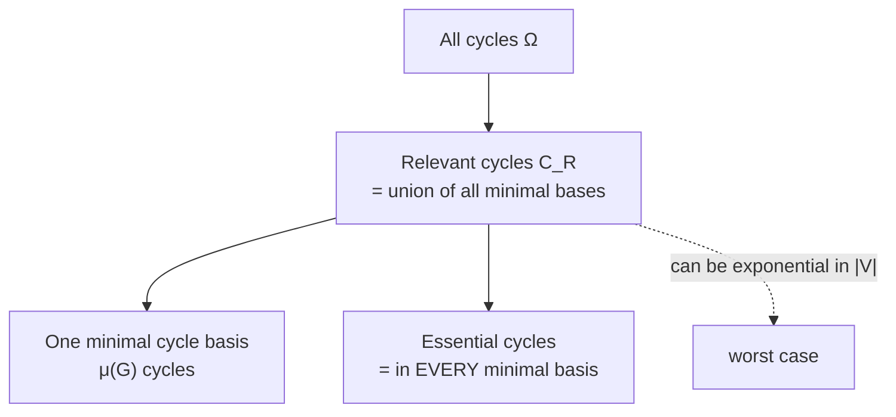

# Relevant Cycles and Vismara's Algorithm

**Relevant cycles** = the union of *all* minimal cycle bases. This set is **unique**, which
fixes the main defect of the SSSR — at the price of being potentially exponential.

## Motivation

Cycles of a minimal cycle basis are:
- close to the chemical understanding of rings (though the cube case is unresolved),
- computable in polynomial time, **but not unique**.

## Definition (Plotkin)

> A cycle is **relevant** iff it belongs to **at least one** minimal cycle basis.
> `C_R` is the set of relevant cycles.

**The set of relevant cycles is unique.**

## Vismara's theorem

> A cycle `Z` is relevant **iff** there is **no** set `C₁,…,C_k` of elementary cycles with
> 1. `|C_i| < |Z|` for all `i ∈ [1,k]`, and
> 2. `Z = C₁ ⊕ C₂ ⊕ … ⊕ C_k`

In words: a cycle is relevant iff it cannot be written as a sum of strictly shorter cycles.

## Number of relevant cycles

`p = |C_R|` is computable in polynomial time, but **p itself can be exponential** in the
number of nodes (worst case: a chain of fused rings with many symmetric alternatives).


*Containment hierarchy: essential ⊆ basis ⊆ relevant ⊆ all cycles.*

## Vismara's idea

1. Partition the relevant cycles into **families** (polynomially many).
2. Compute a **prototype** for each family (Horton-style).
3. Compute the **size** of each family (gives `p`).
4. **Enumerate** the family (gives `C_R`).

### Normal form

Starting from a node order ≺, every relevant cycle `Z` can be described by a **base node**
`r(Z)` and an edge `e(Z) = (x,y)` (odd cycles), or two edges `e(Z) = e e' = (x,y,z)`
(even cycles), with:

```text
∀u ∈ ( p(r,x) ∪ p(r,z) ∪ {y} ) \ {r} :  r ≺ u
```

### Relevant Cycle Families (RCF)

> Let `C` be a relevant cycle. Its **family** is
> `F(C) = { C' ∈ C_R : |C| = |C'| ∧ r(C) = r(C') ∧ e(C) = e(C') }`

- RCFs form a (non-unique) **partitioning** of `C_R`; the number of partitions `|RCF|` is
  **polynomial** in G.
- Goal: compute one **prototype cycle** per RCF, called the **RCP** (relevant cycle prototype).

## Computing the candidate set

**Shortest Path Neighbourhood** `V_r` w.r.t. ≺: for a node `r`,

```text
V_r = { z ∈ V | ∃ shortest path p(r,z) with ∀u ∈ p(r,z)\{r} : r ≺ u }
```

`V_r` including the shortest paths can be computed with a **BFS**.

```text
ALGORITHM CREATE-INITIAL-CYCLESET(G)              # Vismara variant of Horton's
  for each r ∈ V:
      V_r, p, d <- BFS-SHORTEST-PATHS(G, r, ≺)
      for each y ∈ V_r:
          S <- ∅
          for each z ∈ V_r ∩ y.Adj:               # predecessors of y along shortest paths
              if d(r,z) == d(r,y) − 1:
                  S <- S ∪ {z}
              else if d(r,z) == d(r,y) and z ≺ y and p(r,y) ∩ p(r,z) == {r}:
                  C_I' <- C_I' ∪ { p(r,y) ∪ p(r,z) ∪ (z,y) }      # odd cycles
          for each pair x, z ∈ S:
              if p(r,x) ∩ p(r,z) == {r}:
                  C_I' <- C_I' ∪ { p(r,x) ∪ p(r,z) ∪ (x,y) ∪ (y,z) }   # even cycles
  return C_I'
```

## Vismara's algorithm

```text
ALGORITHM Vismara-Calc-Relevant-Cycle-Prototypes(G)
  INPUT : graph G
  OUTPUT: C_R' (prototypes) and the cycle basis C_< ∪ C_=

  C_I'      <- CREATE-INITIAL-CYCLESET(G)
  SORT(C_I', cycle-length())
  C_R'      <- ∅            # prototypes
  C_< <- ∅ ; C_= <- ∅       # cycle basis is C_< ∪ C_=
  prev_size <- 0 ; max_size <- |V|

  while |C_< ∪ C_=| < μ(G)  or  prev_size ≤ max_size:
      Z <- C_I'.head() ; C_I' <- C_I'.tail()
      if Z.size() > prev_size:
          C_< <- C_< ∪ C_= ;  C_= <- ∅
          prev_size <- Z.size()
      if C_<.is-independent-cycle(Z):        C_R' <- C_R' ∪ {Z}      # relevant
      if (C_< ∪ C_=).is-independent-cycle(Z):
          C_= <- C_= ∪ {Z}                                            # part of basis
          if |C_< ∪ C_=| == μ(G): max_size <- Z.size()
```

**The two checks**: C is split into `C_<` (cycles strictly shorter than the current Z) and
`C_=` (cycles of equal length).
- Z is **relevant** ⟺ `C_< ∪ {Z}` is independent.
- Z **extends the basis** ⟺ `C_< ∪ C_= ∪ {Z}` is independent.

**Termination**: for every relevant cycle Z there is a basis containing Z. If C is a cycle
basis whose largest cycle has n edges, then there is no relevant cycle with n+1 edges.
⇒ terminate as soon as C is a cycle basis **and** the current cycle Z is larger than the
last cycle added to C.

**Runtime**: `O(|V|·|E|²)` (generating `C_I`) + `O(μ·|E|³)` (generating `C_R'`).

## Enumerating relevant cycles from prototypes

- For each root node `r`, compute the **directed graph of shortest paths** `(V_r, E_r)`:
  `(y,z) ∈ E_r` if `(z,y)` lies on a shortest path containing no node `u` with `u ≺ r`.
  `G_r` can be computed inside `CREATE-INITIAL-CYCLESET()`.
- **LIST-PATHS()** enumerates all shortest paths in `(V_r, E_r)` by backtracking.

```text
ALGORITHM EnumerateRCF(RCP Z with root r and edge (y,z))
  P1 <- LIST-PATHS(r, y)
  P2 <- LIST-PATHS(r, z)
  return { p1 ∪ (y,z) ∪ p2 : p1 ∈ P1, p2 ∈ P2 }    # all combinations
  # O(|V| · |C_R|) — optimal
```

## See also

- [[concepts/sssr-and-minimal-cycle-basis]]
- [[concepts/horton-algorithm]]
- [[concepts/unique-ring-families]]
- [[exercises/ciw-e3-cycle-bases-and-linkers]]

## Sources

- [[sources/ciw-02-substructure-search-and-ring-perception]] (pp. 18–23)
