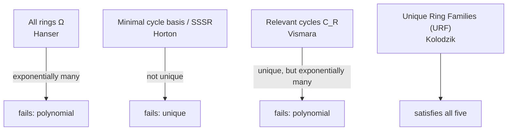
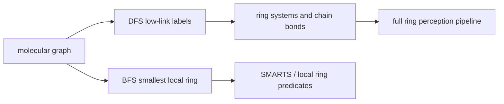

# Ring Perception

Deciding **how many rings a molecule has** and **which rings each atom belongs to** — a
surprisingly hard question with no single correct answer.

## The two questions

1. How many rings does a molecule have?
2. To how many rings does an atom belong?

**Applications**: synthesis planning, definition of aromaticity, searching molecular structures.

## Requirements on a ring description (Randbedingungen)

| Requirement | Meaning |
|---|---|
| **chemically sensible** | matches a chemist's intuition of a ring |
| **universal** | applicable to every molecule |
| **unique** | unambiguously derivable from the molecular structure |
| **polynomial** | the number of rings should be polynomial in molecule size |
| **efficiently computable** | practical runtime |

No single ring concept satisfies all five — this is the whole story of the topic:


*The progression of ring concepts, each fixing a defect of the previous one.*

## Pipeline

```text
ALGORITHM RingPerception(molecule M)
  INPUT : molecular graph
  OUTPUT: ring description

  1  G       <- molecularGraph(M)
  2  BCCs    <- biconnectedComponents(G)          # O(|V|+|E|), one DFS
  3  chains  <- BCCs with exactly one edge        # acyclic bonds
  4  for each ring system R in BCCs with ≥ 2 edges:
  5      μ   <- |E_R| − |V_R| + 1                 # cyclomatic number
  6      basis <- minimalCycleBasis(R)            # Horton
  7      C_R   <- relevantCycles(R)               # Vismara
  8      URFs  <- uniqueRingFamilies(C_R)         # Kolodzik
  9  return chains, URFs
```

## Stages

1. [[concepts/biconnected-components-and-acyclic-bonds]] — separate ring bonds from chain bonds.
2. [[concepts/hanser-all-rings-algorithm]] — enumerate all cycles (Ω).
3. [[concepts/cycle-space-and-cycle-basis]] — the algebraic framework.
4. [[concepts/sssr-and-minimal-cycle-basis]] — the chemically intuitive but ambiguous answer.
5. [[concepts/horton-algorithm]] — how to compute a minimal cycle basis.
6. [[concepts/relevant-cycles-and-vismara]] — the unique but large answer.
7. [[concepts/unique-ring-families]] — the practical answer.

## Connection to SMILES generation

GCI uses DFS ring detection for [[concepts/smiles-generation]]: if a depth-first traversal encounters a previously visited atom that is not the parent, the edge is a ring-closing back edge and receives a ring number.

```text
PROCEDURE DetectSMILESRingClosure(v, w, parent)
  INPUT : current atom v, neighbour w, DFS parent
  OUTPUT: whether edge (v,w) needs a SMILES ring number

  if visited[w] and w != parent:
      return true
  return false
```

Source: [[sources/gci-01-foundations-of-cheminformatics]] (pp. 27-28).

## Ring information in SMARTS and canonical SMILES

GCI part 2 reuses ring information in two ways: SMARTS can query ring membership (`R<n>`), smallest SSSR ring size (`r<n>`), ring bonds (`x<n>`) and ring bonds as bond primitives (`@`), while canonical SMILES generation must assign ring numbers consistently during recursive printing.

```text
PROCEDURE SMARTSRingPredicate(atom a, ringModel)
  INPUT : atom and selected ring model
  OUTPUT: ring-related query properties

  ringCount <- number of rings containing a under ringModel
  smallestRing <- size of the smallest ring containing a, if any
  ringBondCount <- number of incident bonds that lie in a ring
  return R = ringCount, r = smallestRing, x = ringBondCount
```

Source: [[sources/gci-02-inchi-canonical-smiles-and-smarts]] (pp. 20, 27-29).

## Local ring size and ring/chain split in GCI part 3

GCI part 3 separates two jobs that are often conflated: local smallest-ring search and global decomposition into cyclic versus acyclic bonds. [[concepts/smallest-ring-search]] uses BFS depths to find a short cycle around an atom or bond, while [[concepts/biconnected-components-and-acyclic-bonds]] uses low-link DFS to classify every bond.

```text
PROCEDURE RingInformationForQuery(G, atomOrBond x)
  INPUT : molecular graph and local query position x
  OUTPUT: local ring size plus global ring/chain classification

  smallest <- SmallestRingSearch(G, x)
  cyclicBonds <- TarjanCyclicAndAcyclicBonds(G)
  bccs <- biconnected components induced by cyclic bonds
  return smallest, cyclicBonds, bccs
```


*Local smallest rings and global ring systems answer different ring questions.*

Source: [[sources/gci-03-stereochemistry-rings-substructure-and-mcs]] (pp. 6-16).

## See also

- [[concepts/canon-smiles-algorithm]]

- [[concepts/smarts]]

- [[concepts/smallest-ring-search]]

- [[concepts/rotatable-bonds]]

- [[concepts/linkers-and-chains]]
- [[exercises/ciw-e3-cycle-bases-and-linkers]]
- [[exercises/gci-e3-stereochemistry-rings-subgraph-and-mcs]]

## Sources

- [[sources/ciw-02-substructure-search-and-ring-perception]] (pp. 9–25)
- [[sources/gci-01-foundations-of-cheminformatics]] (pp. 27-28)
- [[sources/gci-02-inchi-canonical-smiles-and-smarts]] (pp. 20, 27-29)
- [[sources/gci-03-stereochemistry-rings-substructure-and-mcs]] (pp. 6-16)
