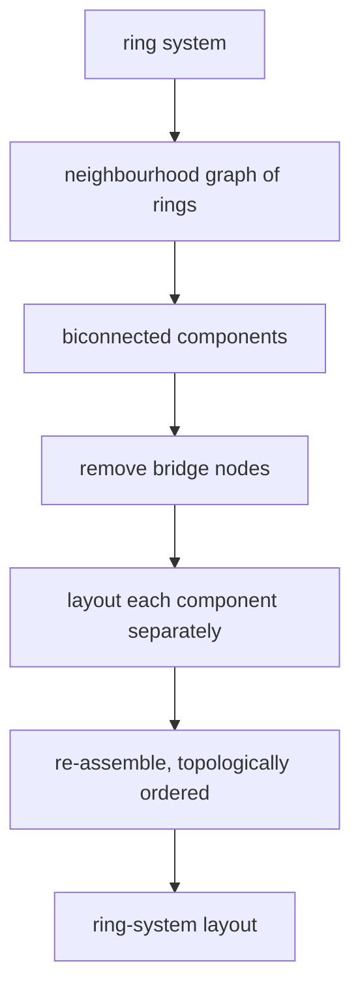

# Ring System Layout

The sub-problem of [[concepts/structure-diagram-generation]] that draws a connected ring
system, using a decomposition into biconnected components plus a template database.

## Why it matters

Ring systems are where SDG breaks: an iterative atom-by-atom placement has no way of knowing
that six atoms must close back on themselves at exactly the right angles. Ring systems are
therefore laid out *as units* and only then embedded into the rest of the diagram.

## Analytical decomposition method

```text
ALGORITHM DrawRingSystem(ring system R)
  1. build the neighbourhood graph            // ring adjacency
  2. compute the biconnected components
  3. remove all bridge nodes (α and β) from the graph
  4. generate the layout for the individual components
  5. re-assemble the components into one ring system in the topologically
     correct arrangement
```


*Decompose, lay out the pieces independently, then glue them back together in the right order.*

Note the reuse of [[concepts/biconnected-components-and-acyclic-bonds]] — the same
decomposition that made [[concepts/ring-perception]] tractable also makes ring *drawing*
tractable.

## Three layout strategies

| Strategy | When used |
|---|---|
| **Regular polygon** | a single ring of size `R ≤ 8` that forms its own biconnected component is drawn directly as a regular polygon |
| **Ring database (RDB) template** | a stored template is looked up for known ring systems |
| **Force-field based** | fallback ("Fallback-Methode") if a ring system cannot be drawn otherwise |

### Ring database

- stores only the **ring skeleton**, without atoms and bond types
- uses a **hash table** for access
- hash values are computed from the **one-dimensional representation** of the ring system
  (e.g. **USMILES**)

Dropping atom and bond types from the key is what makes the database small: benzene,
pyridine and cyclohexadiene all share one skeleton and therefore one template.

### Force-field method

- used when no template matches and the polygon rule does not apply
- **qualitatively inferior** to the other two
- e.g. a **spring model** (nodes repel, bonds act as springs)

## Caveats

- Templates only help for ring systems someone has already entered; novel macrocycles fall
  through to the force field.
- The re-assembly step (5) must preserve the topological order of the components, otherwise
  the diagram is chemically wrong even though every component is individually correct.

## See also

- [[concepts/structure-diagram-generation]]
- [[concepts/biconnected-components-and-acyclic-bonds]]
- [[concepts/ring-perception]]
- [[concepts/collision-detection-scan-line]]

## Sources

- [[sources/ciw-03-pattern-mining-diagrams-surfaces-and-reduced-graphs]] (p. 10)
