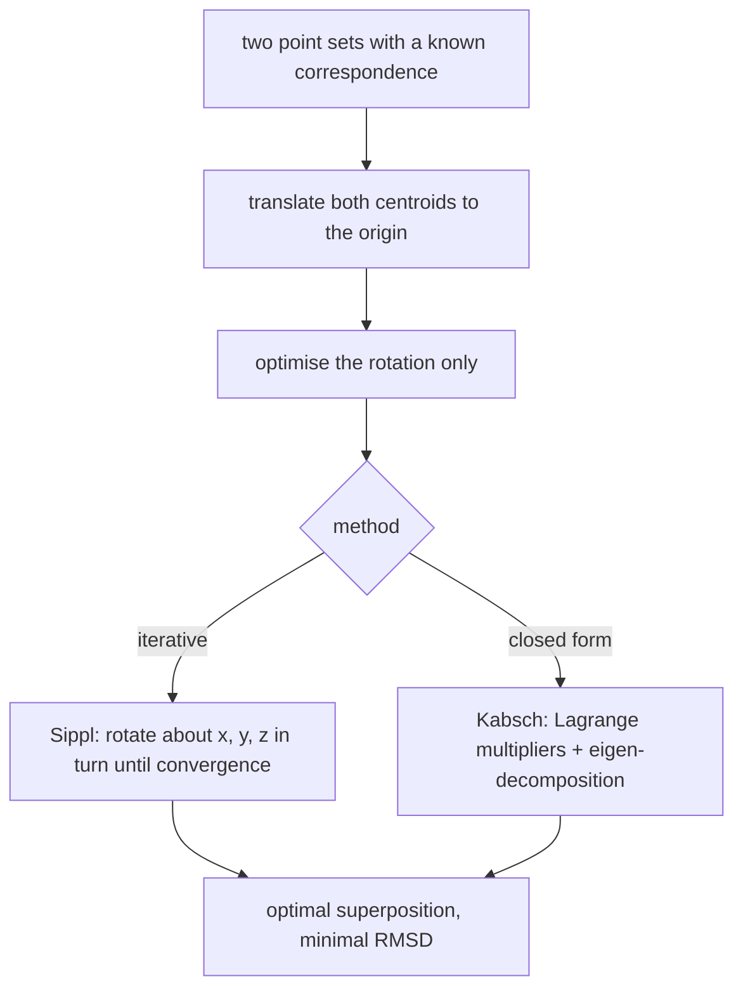

# RMSD and Superposition of Point Sets

The one part of the superposition problem that can be solved **exactly**: given a
*correspondence* between two point sets, find the rigid transformation minimising the RMSD.

## Problem

```text
given  : sets X = x₁, …, x_n  and  Y = y₁, …, y_n  of vectors in ℝ³
sought : a transformation (t, R) minimising

                            ______________________________
         RMSD_{X,Y}(R,t) = √ (1/n) Σ_{i=1..n} (x_i − R y_i − t)²
```

⇒ for determining `(t, R)` only the **sum term** is relevant (the square root and the `1/n`
are monotone transformations).

Note the key difference from [[concepts/seal-algorithm]]: here the correspondence
`x_i ↔ y_i` is **given**. That is what turns a heuristic search into a closed-form problem.

## Optimising the translation

The optimisation of `R` and `t` **decouples**:

```text
let R be a rotation, c(Y) = (1/n) Σ_i y_i the centroid, and Y' = R·Y. Then

R_{X,Y'}(t) = Σ_i (x_i − y'_i − t)²
            = Σ_i (x_i − y'_i)² − 2t Σ_i (x_i − y'_i) + n t²

R'_{X,Y'}(t) = −2 Σ_i (x_i − y'_i) + 2 n t     = 0

⇒  t = (1/n) Σ_i (x_i − y'_i) = c(X) − c(Y') = c(X) − c(Y)
```

⇒ **shift the point sets so that their centres of mass lie on top of each other.** In what
follows one may therefore assume `c(X) = c(Y) = 0` and optimise the rotation alone.


*Decoupling is the whole trick: centre first, then solve a pure rotation problem.*

## Optimising the rotation — Sippl (iterative)

```text
to optimise :  F_{X,Y}(α, β, γ) = Σ_i ( x_i − M_z(γ) M_y(β) M_x(α) y_i )²
```

**1) Rotation about one axis.** Rotation matrix for angle `γ` about the z-axis:

```text
            ⎛ cos γ   −sin γ   0 ⎞
M_z(γ)  =   ⎜ sin γ    cos γ   0 ⎟
            ⎝   0        0     1 ⎠
```

Substituting into `F` and differentiating gives

```text
∂F(γ)/∂γ = 2 sin γ Σ_i (x_i1 y_i1 + x_i2 y_i2) + 2 cos γ Σ_i (x_i1 y_i2 − x_i2 y_i1)

U       = XᵀY
γ_min   = arctan[ (u₂₁ − u₁₂) / (u₁₁ − u₂₂) ]
```

**2) Iterative approach to the optimal rotation** by successive rotation about the x-, y-
and z-axes:

```text
U_M = Xᵀ Y_M = U Mᵀ           (M is a rotation matrix)

the optimisation cycle is independent of U:
    for (a, φ) ∈ { (x,α), (y,β), (z,γ) } :       # e.g. in the order y, x, z
        determine φ_min
        U = U · M_a(φ_min)ᵀ

stop : sum of the angle changes < δ
```

## Optimising the rotation — Kabsch (closed form)

```text
the rotation matrix U is orthonormal:  UᵀU = E
apply the Lagrange method for constrained minimisation:  G_{X,Y}(U, L)

differentiating G gives      U(S + L) = R
                             RᵀR = (S + L)ᵀ (S + L)

eigenvectors a₁, a₂, a₃ and eigenvalues μ₁ ≥ μ₂ ≥ μ₃ of RᵀR

rotation matrix:
    U = R [S + L]⁻¹ = R A Λ⁻¹ Aᵀ
        Λ = diag( √μ₁, √μ₂, √μ₃ )
        A = ( a₁, a₂, a₃ )
```

Kabsch gives the optimum in one shot, with no iteration and no start-value dependence —
the reason it, rather than Sippl's method, is what structural-biology software actually
uses.

## Caveats

- Both methods require the **correspondence to be known**; finding it is the hard part in
  [[concepts/flexible-superposition]].
- The RMSD is dominated by the worst-fitting atoms, since the deviations are squared.
- A naive eigen-decomposition can return a reflection rather than a rotation
  (`det U = −1`); the lecture page notes `det` at the bottom margin.

## See also

- [[concepts/molecular-superposition]]
- [[concepts/seal-algorithm]]
- [[concepts/flexible-superposition]]
- [[concepts/hierarchical-clustering]]

## Sources

- [[sources/ciw-04-descriptor-evaluation-clustering-and-superposition]] (pp. 25–27)
