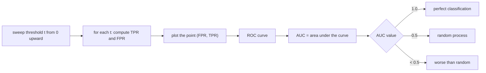

# ROC Curves and AUC

**Receiver Operating Characteristic** — a method for comparing classification *models* by
plotting sensitivity against 1 − specificity as the decision threshold sweeps over its
whole range.

## Confusion matrix

Classification of the instances:

| | actual **p** | actual **n** | |
|---|---|---|---|
| predicted **p'** | TP | FP | P' |
| predicted **n'** | FN | TN | N' |
| | P | N | |

## Rates

```text
TPR = TP / P = TP / (TP + FN)        # sensitivity, hit rate
TNR = TN / N = TN / (TN + FP)        # specificity
FPR = FP / N = FP / (FP + TN)        # = 1 − specificity
Acc = (TP + TN) / (P + N)            # accuracy
```

## The curve

- The relative frequency distribution is computed **for every possible parameter value**:
  shift the threshold `t` from 0 to large and enter the resulting point `(FPR, TPR)`.
- Axes: **TPR / sensitivity** vertically, **FPR (= 1 − spec)** horizontally.
- The diagonal is the random process; curves **above** it are better, **below** it worse.
- Perfect classification is the top-left corner.


*Each threshold gives one point; the collection of points is the curve, and its area is the summary statistic.*

## AUC

> **AUC** takes values in `[0, 1]`. A **random process gives 0.5**.

The ROC curve is also used as an **optimisation method**: the threshold is chosen at the
point on the curve that best trades sensitivity against specificity for the application at
hand.

## Caveats

- AUC is threshold-free, which is its strength and its weakness: it rewards a model for
  ranking well *everywhere*, whereas in [[concepts/virtual-screening]] only the top of the
  ranking is ever looked at — which is why [[concepts/enrichment-factor]] is reported
  alongside it.
- Accuracy is misleading on the heavily imbalanced datasets typical of screening (few
  actives, many inactives); TPR/FPR are not.

## See also

- [[concepts/enrichment-factor]]
- [[concepts/virtual-screening]]
- [[concepts/high-throughput-screening]]
- [[concepts/clustering-of-molecules]]

## Sources

- [[sources/ciw-04-descriptor-evaluation-clustering-and-superposition]] (p. 2)
