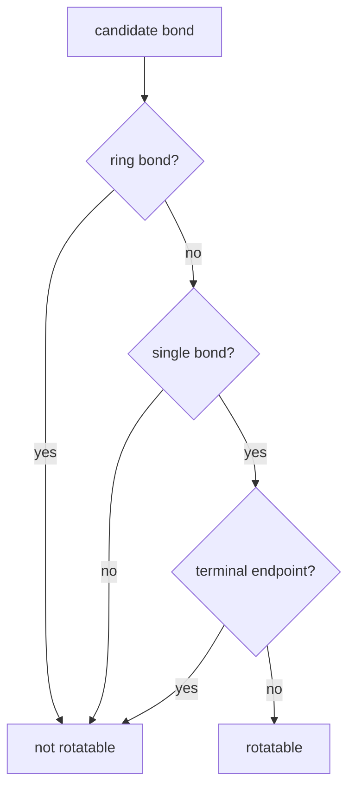

# Rotatable Bonds

A rotatable bond is a non-ring single bond between non-terminal atoms that can act as a torsional degree of freedom.

## Why it matters

Rotatable bonds determine the size of conformational search spaces and explain why [[concepts/molecular-conformation]] and flexible methods are combinatorial. GCI part 3 derives them from cyclic/acyclic bond labelling.

## How it works

The notes use three filters: the bond must not be cyclic, it must be a single bond, and both endpoints must have additional neighbours.

```text
ALGORITHM RotatableBonds(G)
  INPUT : molecular graph G with bond orders
  OUTPUT: set of rotatable bonds

  cyclic <- TarjanCyclicAndAcyclicBonds(G)
  rotatable <- empty set
  for each bond e = (u,v) in E(G):
      if cyclic[e] == false and
         bondOrder(e) == single and
         degree(u) > 1 and degree(v) > 1:
          add e to rotatable
  return rotatable
```


*A rotatable bond is a chain single bond with substituents on both sides.*

## Practical notes

- Terminal single bonds are excluded because rotating a terminal atom does not change the heavy-atom conformation meaningfully in the source's graph treatment.
- Ring single bonds are excluded because the ring closes the torsion.

## Limitations / caveats

- The source gives a graph rule, not a medicinal-chemistry descriptor standard; toolkits may exclude amide bonds or use additional chemical filters.

## See also

- [[concepts/molecular-conformation]]
- [[concepts/biconnected-components-and-acyclic-bonds]]
- [[concepts/conformation-generation]]

## Sources

- [[sources/gci-03-stereochemistry-rings-substructure-and-mcs]] (pp. 15-16)
