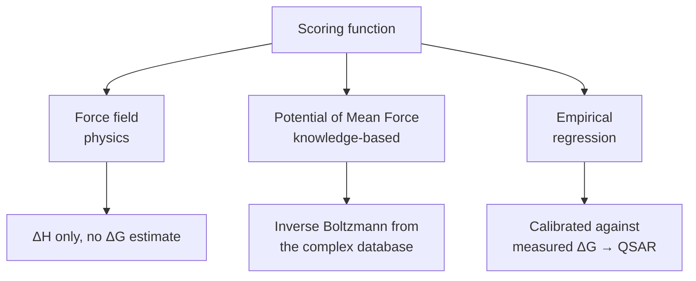
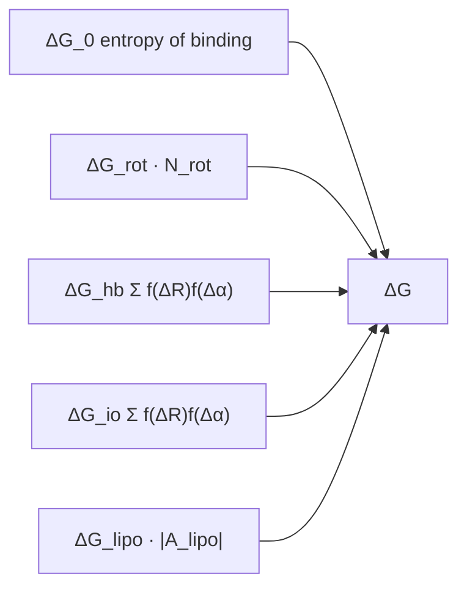

# Scoring functions

**Given** the 3D structure of a protein–ligand complex, **estimate** the free binding energy
ΔG (free enthalpy).

## Why it matters

The scoring function is where [[concepts/docking]] meets the thermodynamics of lecture 1.
It is also the acknowledged weak point of the whole field: pose search is largely solved,
scoring is not.

## The thermodynamic setting

```text
ΔG = −RT ln K_i                 K_i = [P][L] / [PL]
ΔG = ΔH − TΔS                   ΔH enthalpic, ΔS entropic energy

The MEASURED ΔG describes the energy difference between the bound and
unbound state; it is based on an ENSEMBLE of complex structures.

ASSUMPTION: the measured ΔG is described by a SINGLE structure with
            minimal energy.
```

That assumption is the original sin of scoring. An ensemble average is replaced by one
minimum-energy pose, which throws away exactly the entropic term
([[concepts/binding-thermodynamics]], [[concepts/enthalpy-entropy-compensation]]).

## The three families


*Three different answers to "where does the energy number come from": a theory, a statistic, or a fit.*

### 1. Force field

```text
→ describes only the ENTHALPY ΔH, gives no estimate for ΔG
→ conformation terms (bond length / bond angle) have very steep flanks,
  and are possibly not taken into account
→ possibly expensive computation
```

Steep flanks are the same numerical problem CoMFA had ([[concepts/comfa]]) and for the same
reason: [[concepts/lennard-jones-potential]] diverges.

### 2. Potential of Mean Force (PMF)

```text
IDEA: analysis of existing complexes —
      "what occurs frequently is energetically favourable"

PAIR POTENTIALS:
   f(a,b,d) := relative frequency with which atoms of type a and b
               with distance d occur in the complex database
   → conversion into an energy contribution  g_ab(d)   (INVERSE BOLTZMANN)

TOTAL ENERGY:
   E(R,L) =      Σ            g_{a(r) a(l)}( d(r,l) )
            atoms r ∈ R, l ∈ L
```

```text
   frequency f(a,b,d)                energy g_ab(d)
        ^                                 ^
        |    /\                           |  \
        |   /  \        --inverse-->      |   \    /
        |__/    \___     Boltzmann        |    \__/
        +----------> d                    +----------> d
```

The PMF is a statistical model masquerading as a physical one: frequencies in the PDB are
turned into energies by inverting the Boltzmann relation. It implicitly includes solvent and
entropy, because those effects shaped the observed frequencies.

### 3. Empirical scoring functions

```text
→ calibration of microscopic (geometric) properties against measured
  macroscopic ΔG values      →  this is QSAR
→ database: a set of protein–ligand complexes with known 3D structure AND ΔG
```

Explicitly labelled as [[concepts/qsar]] in the notes: same method, different descriptors.

## Böhm's function

```text
ΔG = ΔG_0
   + ΔG_rot  · N_rot
   + ΔG_hb   · Σ f(ΔR) f(Δα)          // neutral H-bonds
   + ΔG_io   · Σ f(ΔR) f(Δα)          // ionic interactions
   + ΔG_lipo · |A_lipo|

ΔG_0    : loss of translational / rotational entropy through binding
ΔG_rot  : loss of conformational degrees of freedom
ΔG_hb   : hydrogen bonds (neutral)
ΔG_io   : hydrogen bonds / interactions (charged)
ΔG_lipo : lipophilic contact surface

The function f PENALISES the deviation of the hydrogen bonds from the
ideal geometry (ΔR in distance, Δα in angle).
The ΔG values are determined by LINEAR REGRESSION.
```

Term by term this is lecture 1 rewritten as a formula:

| Term | Lecture-1 concept |
|---|---|
| ΔG₀ | entropy cost of fixing two bodies → [[concepts/binding-thermodynamics]] |
| ΔG_rot·N_rot | ligand rigidity heuristic → [[concepts/lead-optimization-heuristics]] |
| ΔG_hb, f(ΔR)f(Δα) | H-bond geometry → [[concepts/hydrogen-bond]] |
| ΔG_io | [[concepts/ionic-interactions-and-metal-complexation]] |
| ΔG_lipo·\|A_lipo\| | [[concepts/hydrophobic-effect]], an **area** term → [[concepts/molecular-surfaces]] |


*Five additive terms, each a coarse proxy for one physical effect, with the weights fitted by regression.*

## Caveats

- Additivity again: the terms are summed as if independent, which
  [[concepts/enthalpy-entropy-compensation]] says they are not.
- Empirical functions only generalise within the chemistry of their calibration set — the
  applicability-domain problem of [[concepts/qsar-model-validation]].
- Desolvation ([[concepts/desolvation-and-water]]) appears only implicitly, through the
  lipophilic surface term.

## See also

- [[concepts/docking]]
- [[concepts/binding-thermodynamics]]
- [[concepts/qsar]]
- [[concepts/hydrogen-bond]]
- [[concepts/hydrophobic-effect]]
- [[concepts/lennard-jones-potential]]

## Sources

- [[sources/ciw-05-pharmacophores-qsar-and-docking]] (pp. 25–26)
