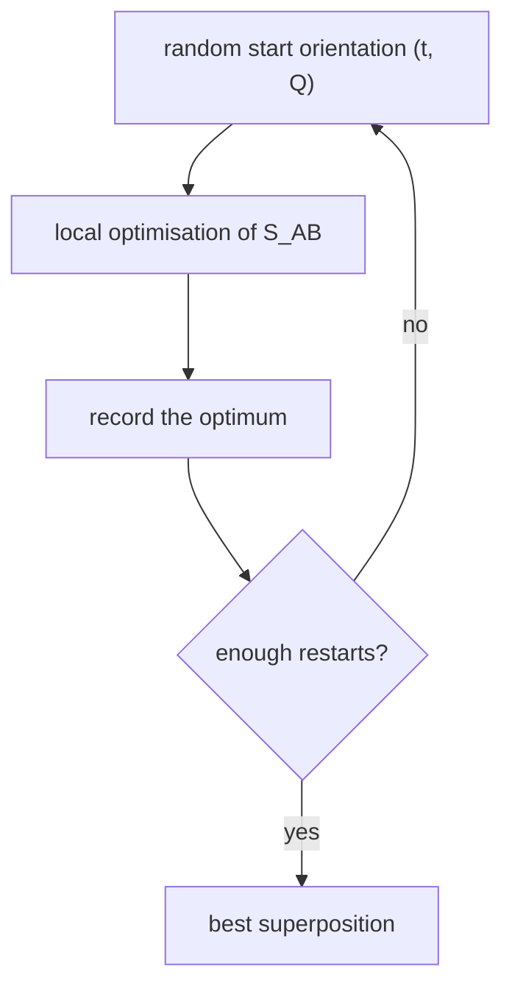

# SEAL — Rigid Superposition

The reference algorithm for **rigid** [[concepts/molecular-superposition]]: maximise the
normalised overlap of Gaussian fields over translation and rotation.

## Simplification

> **Molecular conformations are assumed to be constant and given.**

This is what makes the problem tractable — the search space collapses from
(conformations × poses) to poses alone.

## Model and objective

- Modelling of the **steric and electrostatic field**
  ([[concepts/gaussian-molecular-representation]]).
- **Objective function:** overlap of Gaussian functions for molecule comparison, normalised
  (Hodgkin):

```text
S_AB(t, R)   →   maximise
```

## Degrees of freedom

| DOF | Representation |
|---|---|
| **Translation** | vector `t` |
| **Rotation** | **quaternion** `Q = (q₁, q₂, q₃, q₄)` |

⚠️ Quaternions are used because they have **no singularities** — unlike Euler angles, which
suffer from gimbal lock, where two of the three axes align and a degree of freedom is lost.
A well-behaved gradient everywhere is essential for the local optimiser.

## Search strategy

```text
ALGORITHM SEAL(A, B)
  repeat many times:
      draw a random start orientation (t, Q)
      local optimisation of S_AB(t, Q)        # second derivative available analytically
  return the best optimum found
```


*Multi-start local optimisation: the objective is smooth but multimodal, so the global search is done by random restarts.*

The **second derivative is analytically computable**, so a Newton-type optimiser can be used
and each local optimisation converges in few steps — which is what makes many restarts
affordable.

## Caveats

- Rigid: a molecule in the wrong conformer can never be superposed well, however good the
  optimiser → [[concepts/flexible-superposition]].
- Random restarts give no guarantee of finding the global optimum.
- The result is a pose, not a correspondence between functional groups (see the "purely
  numerical" note in [[concepts/gaussian-molecular-representation]]).

## See also

- [[concepts/gaussian-molecular-representation]]
- [[concepts/molecular-superposition]]
- [[concepts/flexible-superposition]]
- [[concepts/rmsd-and-point-set-superposition]]

## Sources

- [[sources/ciw-04-descriptor-evaluation-clustering-and-superposition]] (p. 15)
