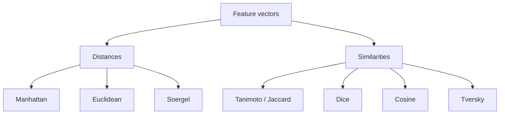

# Similarity and Distance Measures

Similarity and distance measures turn descriptor vectors or feature sets into numeric comparisons between molecules.

## Why it matters

A [[concepts/molecular-fingerprints|fingerprint]] alone does not rank a database. [[concepts/molecular-similarity]] depends on the coefficient: Tanimoto, Dice, Cosine and Tversky can order the same molecules differently unless they are monotone for the compared data.

## How it works

Let binary vectors represent feature sets. The notes use `a = |A|`, `b = |B|`, `c = |A ∩ B|`, and `d` for bits absent from both vectors.


*The same descriptor vectors can be compared as metric-like distances or as normalised similarities.*

## Metric properties

```text
DEFINITION MetricDistance(d, R)
  INPUT : distance function d over objects R
  CONDITIONS:
      for all a,b: d(a,b) >= 0
      for all a:   d(a,a) = 0
      for all a,b: a != b implies d(a,b) > 0
      for all a,b: d(a,b) = d(b,a)
      for all a,b,c: d(a,b) <= d(a,c) + d(c,b)
```

The notes classify conditions 1-4 as semimetric-like and 1,2,4,5 as pseudometric-like.

## Common formulas

| Measure | Numeric/vector form | Binary form |
|---|---|---|
| Manhattan distance | `d1(x,y)=Σ_i |x_i-y_i|` | `a+b-2c` |
| Euclidean distance | `d2(x,y)=sqrt(Σ_i |x_i-y_i|²)` | `sqrt(a+b-2c)` |
| Soergel distance | `Σ_i |x_i-y_i| / Σ_i max(x_i,y_i)` | `(a+b-2c)/(a+b-c)` |
| Tanimoto / Jaccard | `Σ_i x_i y_i / (Σ_i x_i² + Σ_i y_i² - Σ_i x_i y_i)` | `c/(a+b-c)` |
| Dice | `2Σ_i x_i y_i / (Σ_i x_i² + Σ_i y_i²)` | `2c/(a+b)` |
| Cosine | `Σ_i x_i y_i / sqrt(Σ_i x_i² · Σ_i y_i²)` | `c/sqrt(ab)` |
| Tversky | — | `c/(α(a-c)+β(b-c)+c)` |

Soergel distance is the complement of Tanimoto/Jaccard similarity for binary vectors: `d_S = 1 - s_T`.

```text
PROCEDURE RankByTanimoto(query q, molecules D)
  INPUT : query bit vector q and database bit vectors D
  OUTPUT: molecules sorted by decreasing Tanimoto similarity

  for each vector x in D:
      a <- countOnBits(q)
      b <- countOnBits(x)
      c <- countOnBits(q AND x)
      score[x] <- c / (a + b - c)
  return sortDescending(D, score)
```

## Practical notes

- Tanimoto is noted as the usual comparison for topological feature vectors.
- Cosine is noted as efficient in the source.
- Tversky is asymmetric when `α != β`; `α=β=1` gives Tanimoto, and `α=β=1/2` gives Dice.
- Similarity can be converted monotonically from distance by expressions such as `s = 1 - d` or `s = 1/(1+d)` when ranges permit.

## Limitations / caveats

- Different coefficients encode different biases toward molecule size and shared/unique features.
- A mathematical metric is not automatically a chemically meaningful similarity.

## See also

- [[concepts/molecular-similarity]]
- [[concepts/molecular-descriptors]]
- [[concepts/molecular-fingerprints]]
- [[concepts/ecfp-and-fcfp-fingerprints]]

## Sources

- [[sources/gci-04-molecular-glues-descriptors-fingerprints-and-similarity]] (pp. 13-16)
