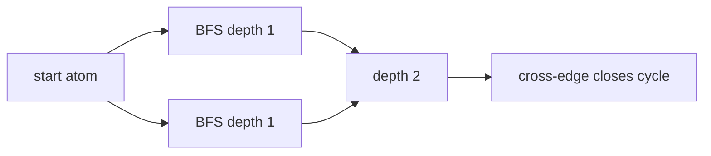

# Smallest Ring Search

Smallest ring search finds a shortest cycle containing a chosen atom or bond by breadth-first exploration of the molecular graph.

## Why it matters

SMARTS ring predicates and ring-aware stereochemical traversal often need local facts such as the smallest ring containing an atom, not a complete ring basis. GCI part 3 presents BFS as the local method before the full [[concepts/biconnected-components-and-acyclic-bonds]] decomposition.

## How it works

Starting from an atom, BFS stores a depth for each reached atom. When the traversal finds an already queued atom that is not the parent, the two BFS paths plus the closing edge define a cycle; the cycle length is computed from the stored depths.

```text
ALGORITHM SmallestRingContainingStart(G, start)
  INPUT : molecular graph G and start atom
  OUTPUT: length of a smallest detected ring, or none

  for each v in V(G): queued[v] <- false; parent[v] <- none; depth[v] <- infinity
  queued[start] <- true; depth[start] <- 0; enqueue start
  smallest <- infinity
  while queue is not empty:
      w <- dequeue
      for each neighbour u of w:
          if not queued[u]:
              queued[u] <- true; parent[u] <- w; depth[u] <- depth[w] + 1; enqueue u
          else if parent[w] != u:
              length <- depth[w] + depth[u] + 1
              if length < smallest: smallest <- length
  if smallest == infinity: return none
  return smallest
  # complexity: O(|V| + |E|) for one start atom
```

```text
PROCEDURE EnumerateRingPath(G, start, length)
  INPUT : graph G, start atom and target ring length
  OUTPUT: paths that close a ring of the given length

  function explore(v, parent, remaining, path):
      append v to path
      if remaining == 0:
          if v == start: output path
          return
      for each neighbour x of v except parent:
          explore(x, v, remaining - 1, path)
```


*The ring length is reconstructed from the two BFS depths and the closing edge.*

## Practical notes

- For a smallest ring containing a bond, run the path search between the bond endpoints while excluding that bond, then add one for the excluded bond.
- The notes mark the method as a local search; complete ring perception still needs BCCs, cycle bases or URFs.

## Limitations / caveats

- The first detected cycle depends on traversal order unless all candidate cross-edges are evaluated and the minimum length is kept.
- Smallest local rings are not the same as a chemically complete ring set.

## See also

- [[concepts/ring-perception]]
- [[concepts/biconnected-components-and-acyclic-bonds]]
- [[concepts/smarts]]

## Sources

- [[sources/gci-03-stereochemistry-rings-substructure-and-mcs]] (pp. 6-8, 10)
