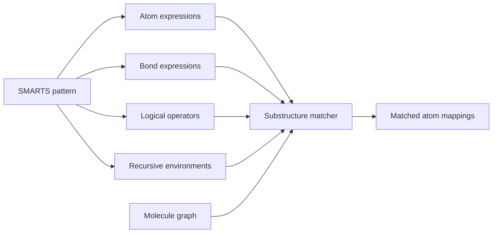

# SMARTS

SMARTS is a SMILES-derived query language for describing chemical substructure patterns by atom and bond properties.

## Why it matters

Substructure search, rule-based filtering and transformation definitions need patterns rather than complete molecules; SMARTS lets a query specify atoms, bonds, rings, charges and environments without enumerating every matching molecule.

## How it works

SMARTS extends [[concepts/smiles]] with atom primitives, bond primitives, recursive specifications and logical operators. A SMARTS pattern is matched as a labelled query graph against a molecule.

```text
PROCEDURE MatchSMARTS(pattern P, molecule M)
  INPUT : SMARTS pattern graph P, molecular graph M
  OUTPUT: all matches of P in M

  parse atom primitives, bond primitives, recursion and logical operators
  for each pattern atom p:
      candidate[p] <- atoms in M satisfying p's atom expression
  recursively assign pattern atoms to distinct molecule atoms:
      require mapped atoms to satisfy atom expressions
      require mapped bonds to satisfy bond expressions
      evaluate recursive SMARTS against the mapped atom environment
      backtrack when any expression fails
  return complete assignments
```


*SMARTS matching is subgraph search with chemical predicates on atoms and bonds.*

## Practical notes

Selected primitives from the GCI notes:

| Primitive | Meaning in the notes |
|---|---|
| `*` | any atom |
| `a` / `A` | aromatic atom / aliphatic atom |
| `D<n>` | atom with explicitly specified bond count `n`, excluding implicit hydrogens |
| `X<n>` | atom with total connectivity `n` |
| `v<n>` | atom with bond-order sum `n` |
| `H<n>` / `h<n>` | atom with explicit or implicit H count constraints |
| `x<n>` | atom with `n` ring bonds |
| `R<n>` / `r<n>` | atom in `n` SSSR rings / atom in smallest SSSR ring of size `n` |
| `-<n>` / `+<n>` | formal charge constraints |
| `#<n>` | atomic number |
| `@` / `@@` | local chirality markers |

Selected bond primitives:

| Primitive | Meaning in the notes |
|---|---|
| empty | single or aromatic bond |
| `-` | aliphatic single bond |
| `/` and `\` | directional single bonds for up/down stereo |
| `=` | double bond |
| `#` | triple bond |
| `:` | aromatic bond |
| `~` | any bond |
| `@` | ring bond |

Logical operators are written in decreasing precedence: `!` for NOT, `&` for high-precedence AND, `,` for OR and `;` for low-precedence AND. Parenthesised recursive SMARTS can constrain an atom by a surrounding environment.

## Limitations / caveats

- The meaning of ring primitives depends on the ring model used by the toolkit, especially SSSR-based predicates.
- SMARTS describes patterns, not complete molecules; using it as a molecule identifier loses the distinction between exact structure and query.

## See also

- [[concepts/subgraph-isomorphism]]
- [[concepts/matched-molecular-pair-analysis]]
- [[concepts/smiles]]
- [[concepts/ring-perception]]

## Sources

- [[sources/gci-02-inchi-canonical-smiles-and-smarts]] (pp. 19-23)
- [[sources/ciw-05-pharmacophores-qsar-and-docking]] (matched-molecular-pair SMARTS route)
