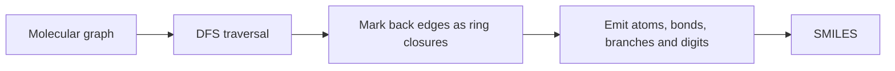
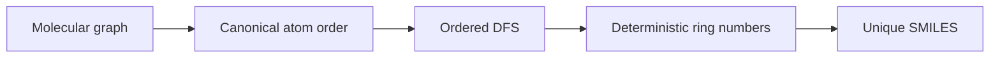

# SMILES Generation

SMILES generation serialises a molecular graph by a depth-first traversal that emits atom labels, bond labels, branches and ring-closure identifiers.

## Why it matters

It connects [[concepts/molecular-graphs]] to the line notation used in databases, exercises and workflow input.

## How it works

```text
ALGORITHM MarkRingEdgesByDFS(G = (V,E))
  INPUT : molecular graph
  OUTPUT: ring-id label r[e] for ring-closing back edges, 0 otherwise

  for each v in V: visited[v] <- false
  nextRingId <- 1
  procedure dfs(v, parent):
      visited[v] <- true
      for each neighbour w of v:
          if w = parent: continue
          if not visited[w]: dfs(w, v)
          else if edge(v,w) not already marked:
              r[edge(v,w)] <- nextRingId
              nextRingId <- nextRingId + 1
  for each unvisited vertex v: dfs(v, none)
  return r
```

```text
ALGORITHM GenerateSMILES(atom a, incomingBond boa, ringIds r, string s)
  INPUT : start atom, optional incoming bond, ring-id map, partial string
  OUTPUT: SMILES string fragment

  if boa exists: s <- s + printBond(boa)
  s <- s + printAtom(a)
  visited[a] <- true
  notFound <- count unvisited non-ring neighbours of a
  for each ring edge b from a:
      if other end already visited: s <- s + printRingId(r[b])
      else s <- s + printBond(b) + printRingId(r[b])
  for each unvisited non-ring neighbour v:
      if notFound > 1: s <- s + "("
      s <- GenerateSMILES(v, bond(a,v), r, s)
      if notFound > 1: s <- s + ")"
      notFound <- notFound - 1
  return s
  # complexity: O(|V| + |E|)
```


*SMILES generation is graph traversal plus syntax emission.*

## Canonical generation

GCI part 2 adds the missing canonicalisation step: before printing a unique SMILES, the atom order, neighbour order and ring-closure numbering must be derived from the molecule rather than chosen by a user traversal.

```text
PROCEDURE GenerateCanonicalSMILES(G)
  INPUT : molecular graph
  OUTPUT: canonical SMILES under one algorithm's rules

  order <- CanonicalizeMolecule(G)
  start <- first atom in order
  for each atom visited during DFS:
      visit neighbours in canonical order
      assign ring numbers deterministically
      print continuation edge first and other edges as branches
  return string
```


*Canonical SMILES generation is ordinary SMILES emission constrained by a canonical order.*

Source: [[sources/gci-02-inchi-canonical-smiles-and-smarts]] (pp. 14-16, 27-29).

## Practical notes

- A ring closure appears when DFS reaches a visited atom that is not the parent.
- Reusable ring IDs can be managed with a stack of free numbers.
- DFS generates one valid traversal-dependent SMILES, not necessarily a canonical one.

## Limitations / caveats

- Stereochemical correctness requires atom-neighbour ordering, not just graph traversal.
- Dynamic chirality and tautomers are outside the simple procedure in the notes.

## See also

- [[concepts/canon-smiles-algorithm]]

- [[concepts/molecular-canonicalization]]

- [[concepts/smiles]]
- [[concepts/molecular-graphs]]
- [[concepts/ring-perception]]

## Sources

- [[sources/gci-01-foundations-of-cheminformatics]] (pp. 27–35)
