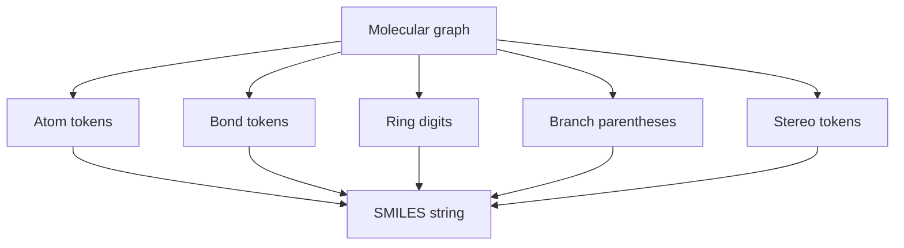
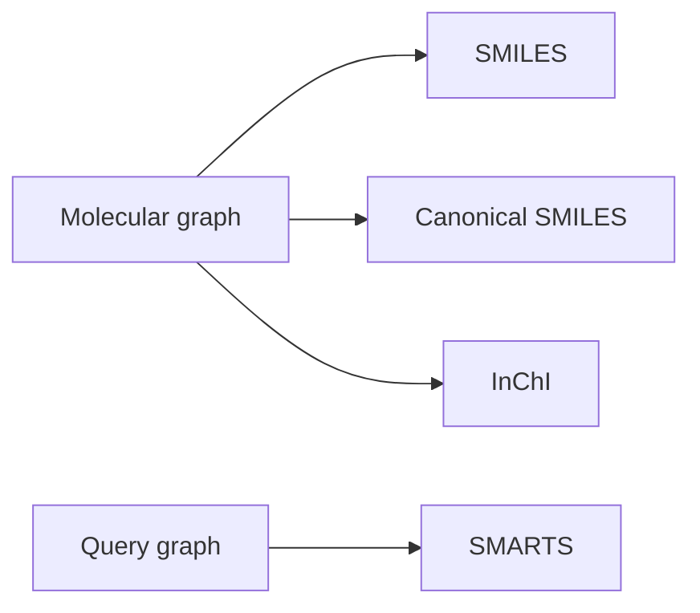

# SMILES

SMILES is a compact line notation that serialises a molecular graph as atoms, bonds, branches, ring numbers and stereochemical symbols.

## Why it matters

SMILES is easy to convert from drawings, compact for databases and a common input to cheminformatics workflows.

## How it works

```text
PROCEDURE ReadBasicSMILES(tokens)
  INPUT : SMILES token stream
  OUTPUT: molecular graph with labels

  current <- none
  branchStack <- empty stack
  ringOpen <- map from digit to atom and bond
  for each token:
      if token is atom: add atom and connect from current if needed; current <- atom
      if token is bond: remember bond for next atom or ring closure
      if token is '(' : push current on branchStack
      if token is ')' : current <- pop branchStack
      if token is digit: open or close ring at current using that digit
      if token is stereo marker: annotate current atom or bond geometry
  return graph
```


*SMILES linearises a graph by making branches and ring closures explicit in syntax.*

## Practical notes

- Organic atoms may be written without brackets in common valence states; bracketed atoms make hydrogens, charges, isotopes and atom mapping explicit.
- Hydrogens are often implicit: methane can be `C`, but explicit forms use brackets.
- Single bonds are often omitted; `=`, `#` and `:` mark double, triple and aromatic bonds.
- Parentheses describe branches; numbers describe ring closure.
- Lowercase atoms denote aromatic atoms.
- `/` and `\` encode double-bond geometry; `@` encodes tetrahedral chirality.

## Canonical and query-related extensions from GCI part 2

GCI part 2 distinguishes three related string uses:

1. ordinary SMILES: a valid traversal-dependent molecule string;
2. canonical or unique SMILES: a deterministic string after [[concepts/molecular-canonicalization]];
3. [[concepts/smarts]]: a query language for substructures rather than a molecule identifier.

```text
PROCEDURE ChooseSMILESUseCase(goal)
  INPUT : intended task
  OUTPUT: suitable string representation

  if goal is drawing or exchanging one valid structure:
      return ordinary SMILES
  if goal is deduplication or stable database keys within one toolkit:
      return canonical SMILES
  if goal is substructure or transformation search:
      return SMARTS
  if goal is cross-database chemical identity:
      return InChI or InChIKey
```


*SMILES-like strings split into molecule strings, canonical identifiers and query patterns.*

Source: [[sources/gci-02-inchi-canonical-smiles-and-smarts]] (pp. 1-23).

## Limitations / caveats

- The GCI notes state that simple SMILES does not represent dynamic chirality or tautomers.
- Many valid SMILES strings can describe the same molecule; canonicalisation is separate.

## See also

- [[concepts/smarts]]

- [[concepts/inchi-and-inchikey]]

- [[concepts/molecular-canonicalization]]

- [[concepts/smiles-generation]]
- [[concepts/molecular-graphs]]
- [[concepts/molecular-file-formats]]
- [[exercises/gci-e1-databases-workflows-and-smiles]]

## Sources

- [[sources/gci-01-foundations-of-cheminformatics]] (pp. 13–26, 29–35)
