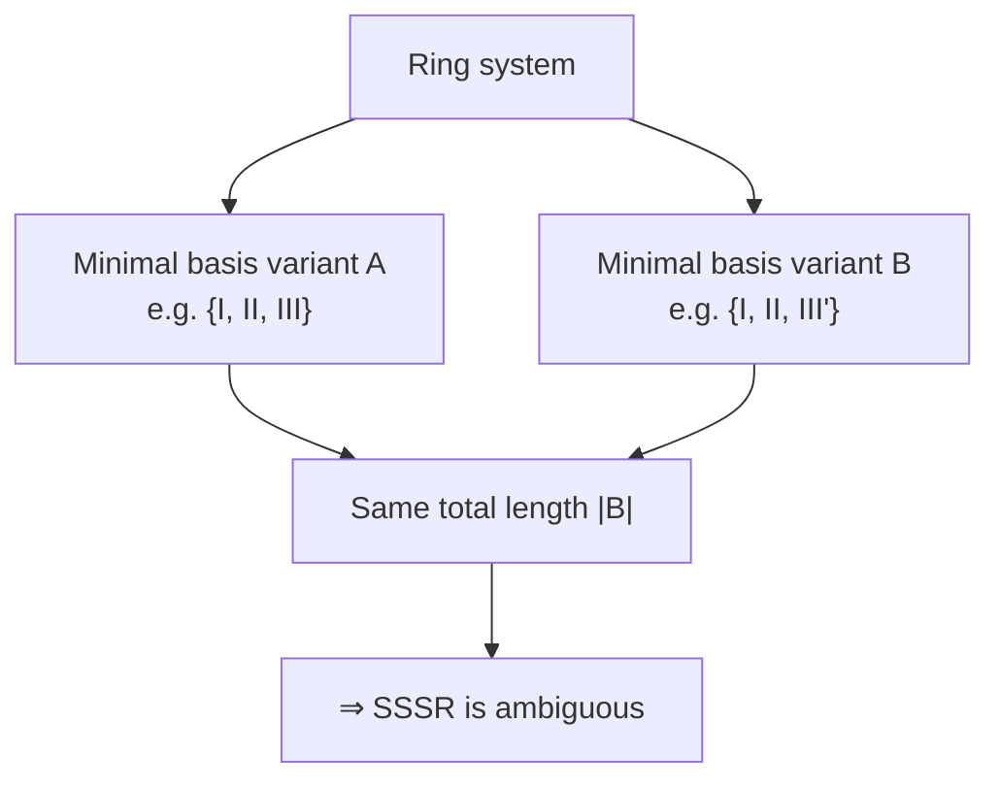

# SSSR and Minimal Cycle Basis

The **Smallest Set of Smallest Rings** — the classic chemical answer to "which rings does
this molecule have", and its formal definition as a *minimal cycle basis*.

## Length of cycles

> Let `C = (V_C, E_C)` be a cycle. Its **length** is `|C| = |E_C|`.
> For a set B of cycles the length is `|B| = Σ_{C ∈ B} |C|`.

## Definition

> A cycle basis B of a graph G with
> `|B| = min { |B'| : B' is a cycle basis of G }`
> is called a **minimal cycle basis** — the **Smallest Set of Smallest Rings (SSSR)**.

## Properties

- A minimal cycle basis consists **only of elementary cycles**.
- **Advantage**: it therefore consists of simple, relatively small rings and is close to the
  chemical understanding of rings. Algorithms for computing minimal cycle bases can be used
  directly.
- **Theorem**: a minimal cycle basis is **not unique**.
- **Disadvantage**: the property of *uniqueness* is lost — one of the five requirements in
  [[concepts/ring-perception]].


*Several different minimal bases can have the same minimal total length — so the answer depends on the algorithm.*

```text
ALGORITHM IsMinimalCycleBasis(B, G)
  INPUT : candidate cycle set B, graph G
  OUTPUT: boolean

  if |B| != μ(G):            return false      # wrong dimension
  if not linearlyIndependent(B): return false
  if not spans(B, C(G)):     return false
  return Σ|C| for C in B == min over all bases
```

## Where it fails

For the **cube** graph, μ = 5, so every basis (including the SSSR) has 5 rings — while a
chemist counts 6 faces. This overcounting/undercounting motivates
[[concepts/relevant-cycles-and-vismara]] and [[concepts/unique-ring-families]].

## See also

- [[concepts/cycle-space-and-cycle-basis]]
- [[concepts/horton-algorithm]]
- [[concepts/relevant-cycles-and-vismara]]
- [[concepts/unique-ring-families]]

## Sources

- [[sources/ciw-02-substructure-search-and-ring-perception]] (p. 14)
