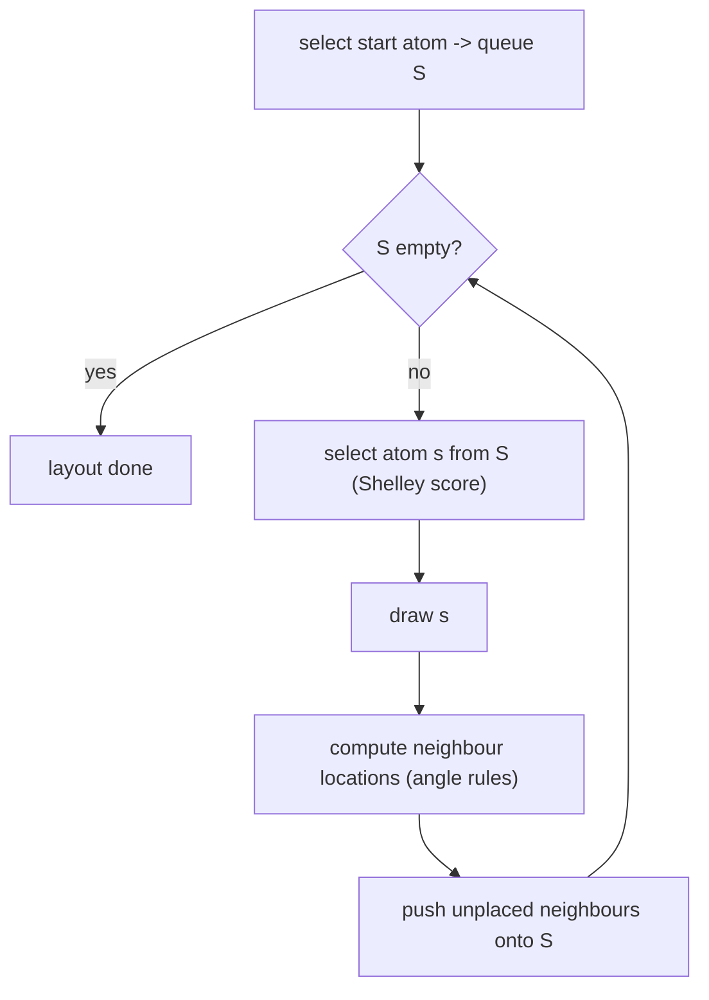

# Structure Diagram Generation (SDG)

Given a molecular graph `G = (V, E)` with chemical annotation, compute a layout
`f : V → ℝ²` that obeys chemical drawing conventions.

## Why it matters

Every depiction of a molecule a chemist ever looks at — in a database hit list, a paper, a
docking result — is produced by SDG. It is the interface between the graph representation
used by [[concepts/subgraph-isomorphism]] and the human reader.

**SDG is NP-hard.**

## Graphical rules for structure depiction

- **Bonds:** lines of equal length.
- **Atoms:** angle-distribution rules.
- **Drawing on a honeycomb (hexagonal) grid.**

### IUPAC conventions

| Element | Rule |
|---|---|
| Bonds | equal length |
| Acyclic atoms | angles as multiples of 30° / 45° |
| Chains | zig-zag and horizontal |
| Rings with size `R ≤ 8` | regular polygons, interior angle `Φ = 180° − 360°/R` |
| Ring systems | horizontal |
| Element symbols | C, and the H attached to it, are not drawn |

Additionally: special rules for naturally occurring molecules (e.g. amino acids, sugars),
and patterning of heteroatoms in heterocycles / orientation of functional groups.

## Basic algorithm — iterative placement

```text
ALGORITHM SDG-Iterative(G)
  INPUT : molecular graph G = (V, E)
  OUTPUT: layout f : V → ℝ²

  S = select start atom from V          // S is a drawing queue (*)
  while (S ≠ ∅):
      s = select atom from S            // (*) heuristics decide which
      draw_atom(s)
      calculate_neighbor_locations(s)   // angle-distribution rules
      for each v ∈ S.adj:
          S = S ∪ {v}
```


*The core loop is a queue-driven traversal; all the intelligence sits in the selection heuristic and in the post-processing.*

Around this core sit four further algorithm families:

1. heuristics for choosing the next atom to draw (the `(*)` steps),
2. algorithms for **collision detection** (plane-sweep / scan-line) —
   [[concepts/collision-detection-scan-line]],
3. algorithms for **collision removal** (local modification of the layout),
4. algorithms for **analysing / drawing ring systems** — [[concepts/ring-system-layout]].

## Choosing the next atom: the Shelley priority score

Goal: **minimise collisions by placing atoms with many bonds early.**

For each atom `a` a score `s_{a,n}` is computed in iteration `n`:

```text
s_{a,0} = 1 + 2δ            // δ = 1 if a is cyclic, 0 if acyclic
s_{a,n} = 3·s_{a,n-1} + Σ_j s_{j,n-1}    // j ranges over the atoms adjacent to a

stop: in practice n = 5, after which the ranking stays constant
```

The recursion spreads "importance" outward from ring atoms and high-degree atoms, so that
the crowded parts of the molecule are placed first, while there is still free space.

## Drawing units

A better layout is obtained by splitting the molecule into **drawing units**:

| Unit | Definition |
|---|---|
| **Chain drawing unit (CDU)** | a longest possible chain of acyclic bonds |
| **Ring drawing unit (RDU)** | a connected ring system |

The iterative algorithm can then be lifted to operate on drawing units instead of atoms.

## Hard cases

- stereochemically restricted systems; regions of high density
- drawing macrocycles
- overcrowded ring systems
- complex substructures are stored as **prefabricated units (PFU)** and placed as a block

## See also

- [[concepts/ring-system-layout]]
- [[concepts/collision-detection-scan-line]]
- [[concepts/protein-ligand-interaction-diagrams]]
- [[concepts/sssr-and-minimal-cycle-basis]]
- [[concepts/molecular-structure-and-stereochemistry]]

## Sources

- [[sources/ciw-03-pattern-mining-diagrams-surfaces-and-reduced-graphs]] (pp. 8–9)
