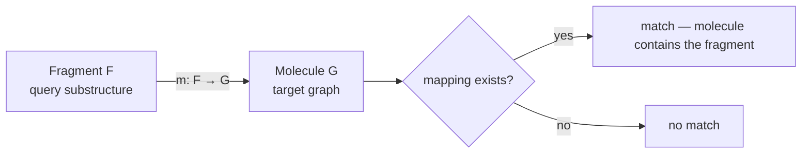
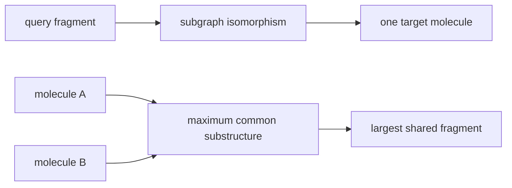

# Subgraph Isomorphism

The formal problem behind **substructure search**: does a query fragment occur inside a
molecule, and where?

## Problem statement

```text
GIVEN  : molecular graph G, fragment F
ASKED  : does F occur as a substructure of G?
         if so, produce a mapping  m : F → G
```

Both are labelled graphs: nodes carry atom types, edges carry bond types. The mapping must
preserve labels *and* adjacency.

GCI part 3 restates this as a bijective mapping from query nodes into a subset of target nodes. For ordinary subgraph matching, every query edge must map to a target edge; for induced matching, non-edges must also be preserved.


*Substructure search = find a label- and adjacency-preserving injection of F into G.*

## Complexity

**Subgraph isomorphism is NP-complete.** There is no known polynomial algorithm; all
practical solvers are exponential in the worst case and rely on pruning to stay fast on
real molecules.

```text
ALGORITHM NaiveSubgraphIsomorphism(G = (V1,E1), F = (V2,E2))
  INPUT : target graph G, query fragment F
  OUTPUT: a mapping m or "no match"

  for each injective mapping m : V2 → V1:          # |V1|! / (|V1|−|V2|)! candidates
      if all labels compatible and
         for all (u,v) in E2: (m(u), m(v)) in E1:
          return m
  return "no match"
  # complexity: exponential — this is why pruning algorithms exist
```

## Practical algorithms

| Algorithm | Approach | Page |
|---|---|---|
| Ullmann | matrix refinement | [[concepts/ullmann-algorithm]] |
| VF2 | state-space search with look-ahead | [[concepts/vf2-algorithm]] |

## Relation to MCS

[[concepts/maximum-common-substructure]] asks for the largest graph that is subgraph-isomorphic to both input molecules. GCI part 3 reduces that optimisation problem to maximum clique using a [[concepts/modular-product-graph]].

```text
PROCEDURE SubgraphToMCSBridge(G1, G2)
  INPUT : two molecular graphs
  OUTPUT: common subgraph search problem

  for a candidate common graph C:
      require an injective subgraph-isomorphism C -> G1
      require an injective subgraph-isomorphism C -> G2
  maximise the chosen size measure of C
```


*MCS is subgraph isomorphism turned into a two-target optimisation problem.*

## Why it matters

Substructure search is the basic query operation of every chemical database: "show me all
compounds containing this scaffold". It also underlies fragment-based descriptors and
reaction-site detection.

## See also

- [[concepts/ullmann-algorithm]]
- [[concepts/vf2-algorithm]]
- [[concepts/maximum-common-substructure]]
- [[concepts/molecular-structure-and-stereochemistry]]

## Sources

- [[sources/ciw-02-substructure-search-and-ring-perception]] (p. 1)
- [[sources/gci-03-stereochemistry-rings-substructure-and-mcs]] (pp. 17-22, 26)
