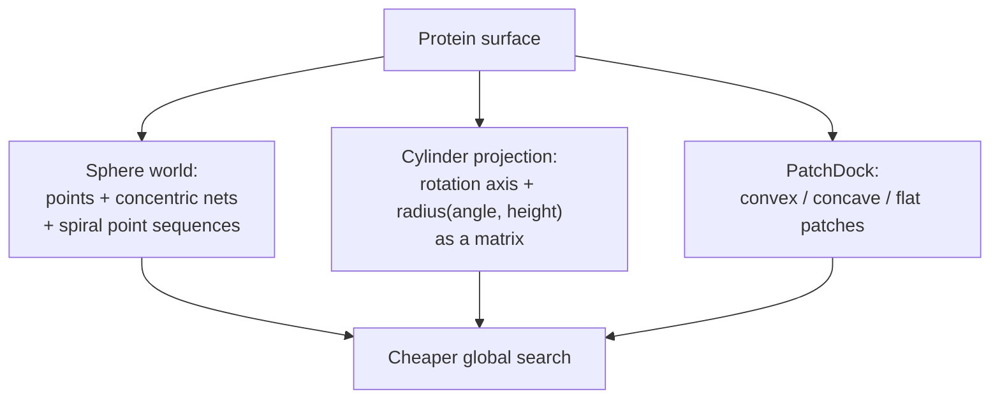

# Surface reduction for protein docking

Alternatives to the dense 3D grid of [[concepts/katchalski-katzir-algorithm]]: reduce the
protein surface to a much smaller representation, then dock the reduced objects.

## Why it matters

A grid over a protein pair contains millions of points, almost all of them irrelevant — the
interface is a thin shell. Reducing the surface first means the search operates on hundreds
of entities rather than millions, at the cost of an approximation.


*Three reductions: to a point set, to a 2D matrix, and to a small set of labelled patches.*

## Sphere world

```text
SPHERE WORLD
  - discretisation of the surfaces by POINTS
  - determination of CONCENTRIC NETS on the surface
  - definition of SPIRAL-SHAPED POINT SEQUENCES on the nets
  - superposition with the Katchalski algorithm,
    then successive adjustment of the parameters
```

The spiral sequence linearises a 2D surface into a 1D signal, which is what allows the same
correlation machinery to be reused on far less data.

## Cylinder surface projection

```text
CYLINDER SURFACE PROJECTION
  - determination of a ROTATION AXIS
  - computation of the change in RADIUS as a function of
    angle and height on the rotation axis   → a MATRIX
  - translation optimisation by searching for
    SIMILAR SUBMATRICES
```

The protein becomes a 2D height map in (angle, height). Complementarity then reduces to
finding submatrices whose radii sum to a constant — a pattern-matching problem in two
dimensions instead of a search in six.

## Geometric docking

### PatchDock

```text
PatchDock
  → decomposition of the surface into
        CONVEX, CONCAVE and FLAT partial surfaces (PATCHES)
  → use of POSE CLUSTERING and GEOMETRIC HASHING to match:
        → convex patches with concave patches
        → flat patches with all others
  → filtering and scoring
```

The matching rule is chemistry-free but effective: a bump belongs in a dent. Flat patches
are promiscuous and therefore matched against everything. The machinery is exactly
[[concepts/pose-clustering]] plus [[concepts/geometric-hashing-docking]], reused at protein
scale.

### FlexDock and FireDock

```text
FlexDock  : handling of DOMAIN MOVEMENTS with hinge bending
FireDock  : refinement of the SIDE-CHAIN placement
            + rigid-body optimisation

⇒ runtime: O("a few hours")
```

FlexDock is [[concepts/place-and-join|hinge bending]] applied to whole protein domains;
FireDock supplies the refinement stage of the
[[concepts/protein-protein-docking|PP docking pipeline]].

## Caveats

- Every reduction discards information; a patch decomposition that misses the true interface
  cannot be repaired downstream.
- Cylinder projection presupposes a meaningful rotation axis, which elongated or multi-lobed
  proteins may not have.
- "A few hours" per complex rules out any screening application.

## See also

- [[concepts/protein-protein-docking]]
- [[concepts/katchalski-katzir-algorithm]]
- [[concepts/pose-clustering]]
- [[concepts/geometric-hashing-docking]]
- [[concepts/place-and-join]]
- [[concepts/molecular-surfaces]]

## Sources

- [[sources/ciw-06-flexible-docking-binding-sites-and-fragment-spaces]] (p. 27)
