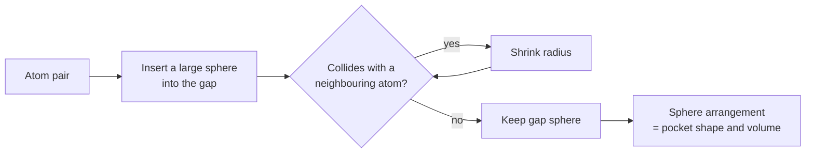

# SURFNET

Grid-free [[concepts/binding-site-detection|binding-site detection]] that finds active sites
via **gap spheres** fitted into the solvent-accessible space between protein atoms.

## Why it matters

SURFNET drops the grid entirely, which removes the orientation and resolution artefacts of
[[concepts/ligsite-and-pocket]]. The pocket is described by the arrangement of the spheres
that fit into it — a continuous, rotation-invariant representation.

## Mechanics

```text
ALGORITHM SURFNET
INPUT : protein 3D structure
OUTPUT: size and shape of the pockets

  FOR each suitable pair of protein atoms:
      fit a sphere into the solvent-accessible space between them
      SHRINK the sphere until no more collisions with
          neighbouring atoms occur
  the ARRANGEMENT of the found spheres describes
      size and shape of the pockets
```


*Each gap sphere is grown as large as the local geometry permits; dense clusters of large spheres mark pockets.*

The sphere idea is the same primitive used by [[concepts/dock-algorithm]] to describe the
negative image of a pocket, and by [[concepts/connolly-surface-algorithm]] to define the
molecular surface — in all three cases a rolling/fitted sphere converts atom positions into
a description of empty space.

## Caveats

- **Problems delimiting wide pockets**: with nothing to stop the spheres, a broad shallow
  groove keeps accepting spheres and the **volume is overestimated**. This is the
  characteristic failure of the sphere family.
- No intrinsic notion of where the pocket ends; a cut-off must be imposed.
- Sensitive to the atom radii used.

## See also

- [[concepts/binding-site-detection]]
- [[concepts/ligsite-and-pocket]]
- [[concepts/pass-algorithm]]
- [[concepts/cast-alpha-shapes]]
- [[concepts/connolly-surface-algorithm]]

## Sources

- [[sources/ciw-06-flexible-docking-binding-sites-and-fragment-spaces]] (p. 9)
