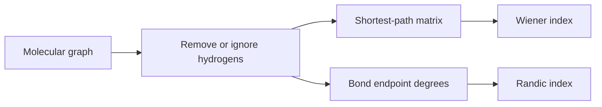

# Topological Indices

Topological indices are scalar graph descriptors that compress molecular connectivity into one number.

## Why it matters

They are early, efficient [[concepts/molecular-descriptors]] for comparing molecules without 3D structures. GCI part 4 highlights the Wiener index for compactness and the Randic index for branching.

## How it works


*The same non-H molecular graph can be reduced either to all-pairs path lengths or to bond-degree products.*

### Wiener index

The Wiener index is the sum of shortest-path distances between all non-H atom pairs.

```text
ALGORITHM WienerIndex(G)
  INPUT : molecular graph G with non-H atoms as vertices
  OUTPUT: Wiener index W

  D <- FloydWarshallShortestPaths(G)
  W <- 0
  for each unordered atom pair {i,j}:
      W <- W + D[i,j]
  return W
```

For a linear alkane-like chain with `N` non-H atoms, the notes give the maximum form `W(N) = (1/6)(N - 1)N(N + 1)`.

### Floyd-Warshall recurrence

```text
ALGORITHM FloydWarshallShortestPaths(G)
  INPUT : graph G with edge length 1 for each bond
  OUTPUT: matrix D of shortest topological distances

  for i,j:
      if i = j: D[i,j] <- 0
      else if i and j are bonded: D[i,j] <- 1
      else: D[i,j] <- infinity
  for k in 1..n:
      for i in 1..n:
          for j in 1..n:
              D[i,j] <- min(D[i,j], D[i,k] + D[k,j])
  return D
  # time: O(n^3), space: O(n^2)
```

### Randic index

The Randic index measures branching by summing inverse square-root degree products over bonds.

```text
ALGORITHM RandicIndex(G)
  INPUT : molecular graph G with non-H atom degrees deg(v)
  OUTPUT: Randic branching index R

  R <- 0
  for each bond (i,j) in E(G):
      R <- R + 1 / sqrt(deg(i) * deg(j))
  return R
```

## Practical notes

- The source notes that molecules with the same number of atoms can be compared by the Randic index.
- The Wiener index is compact but not unique; different graphs can have the same scalar.

## Limitations / caveats

- A scalar descriptor cannot fully reconstruct molecular structure.
- Hydrogens are excluded in the notes for these graph-distance sums.

## See also

- [[concepts/molecular-graphs]]
- [[concepts/molecular-descriptors]]
- [[concepts/similarity-and-distance-measures]]

## Sources

- [[sources/gci-04-molecular-glues-descriptors-fingerprints-and-similarity]] (pp. 4-6)
