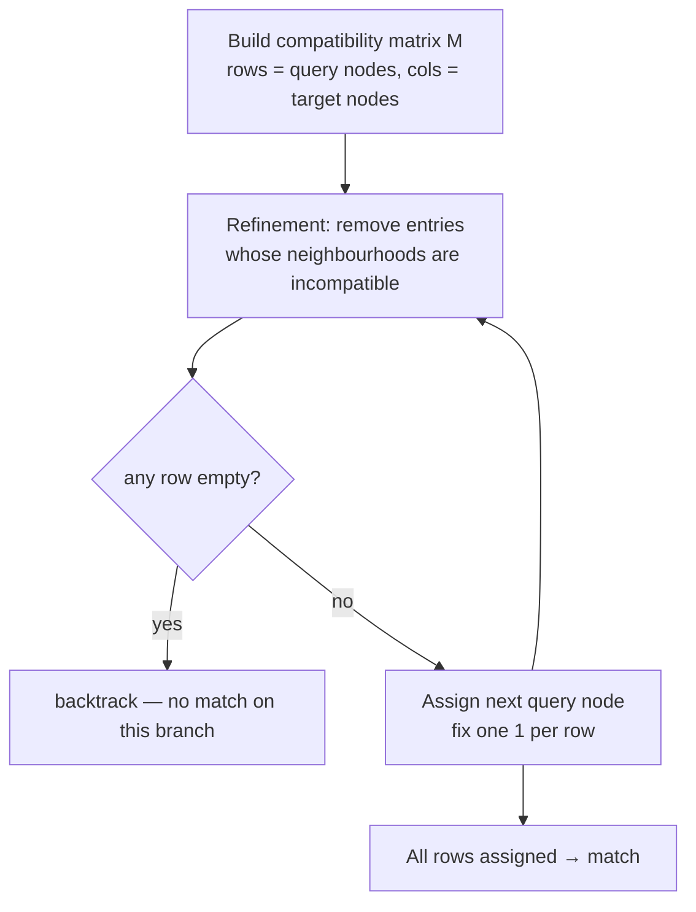

# Ullmann Algorithm

A classic matrix-based solver for [[concepts/subgraph-isomorphism]]: maintain a
compatibility matrix between query and target nodes, and iteratively **refine** it to prune
impossible assignments.

## Idea


*Ullmann alternates between assignment and matrix refinement.*

```text
ALGORITHM Ullmann(G1 = (V1,E1), G2 = (V2,E2))
  INPUT : target G1, query G2
  OUTPUT: all subgraph isomorphisms

  M <- compatibilityMatrix(V2, V1)      # M[i][j] = 1 if query node i may map to target j
  REFINE(M)
  backtrack(depth = 0, M)

PROCEDURE backtrack(d, M)
  if d == |V2|: output mapping from M; return
  for each column j still allowed in row d:
      M' <- M with row d fixed to column j
      REFINE(M')                        # iterative refinement over the WHOLE matrix
      if no row of M' is empty: backtrack(d+1, M')
  # each elementary step costs O(|V1| · |V2|)
```

## Initial matrix and refinement from GCI part 3

GCI part 3 gives the explicit matrix conditions. Rows are query atoms, columns are target atoms. An initial entry `m_ij` is allowed when atom labels are compatible and the target atom has at least the query atom's degree. A valid assignment selects exactly one column in each row and at most one row in each column.

```text
PROCEDURE InitialUllmannMatrix(query F, target G)
  INPUT : query F with a rows, target G with b columns
  OUTPUT: matrix M[a,b]

  for each query atom i in F:
      for each target atom j in G:
          if element(i) == element(j) and degree_G(j) >= degree_F(i):
              M[i,j] <- 1
          else:
              M[i,j] <- 0
  return M
```

```text
PROCEDURE UllmannRefine(query F, target G, matrix M)
  INPUT : current compatibility matrix
  OUTPUT: false if a row becomes empty, otherwise true

  repeat:
      changed <- false
      for each M[i,j] == 1:
          valid <- true
          for each neighbour x of query atom i:
              if no neighbour y of target atom j has M[x,y] == 1:
                  valid <- false
                  break
          if not valid:
              M[i,j] <- 0; changed <- true
              if row i contains no 1: return false
  until not changed
  return true
```

Source: [[sources/gci-03-stereochemistry-rings-substructure-and-mcs]] (pp. 17-25).

## Advantages

- Clean separation between the **compatibility check** of nodes/edges and the **graph
  algorithm** itself.
- **No final subgraph-isomorphism check** is needed — the refinement guarantees validity.
- Extensible to **disconnected** subgraphs and molecules.

## Disadvantages

- The matrix form means individual steps cost **O(|V₁|·|V₂|)**.
- The **iterative modification / re-checking of the entire matrix** (refinement) whenever the
  matching is extended is runtime-intensive.

Two consequences noted in the lecture:
- Efficiency can be gained by extending the matching only **locally**.
- Efficiency is lost when the number of partial matchings in backtracking grows.
- Refinement matters in practice: the GCI exercise contrasts 36 unrefined recursive candidates with a much smaller refined trace.

Both points are exactly what [[concepts/vf2-algorithm]] addresses.

## See also

- [[concepts/subgraph-isomorphism]]
- [[concepts/vf2-algorithm]]
- [[exercises/gci-e3-stereochemistry-rings-subgraph-and-mcs]]

## Sources

- [[sources/ciw-02-substructure-search-and-ring-perception]] (p. 1)
- [[sources/gci-03-stereochemistry-rings-substructure-and-mcs]] (pp. 17-25)
