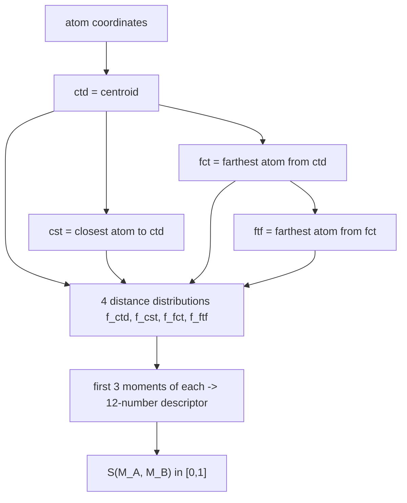

# Ultrafast Shape Recognition (USR)

A **ballistic** shape descriptor (Ballester): describe a molecule's shape by the
distributions of its atom distances to **four reference points**, and compare molecules by
the moments of those distributions.

## Why it matters

Comparing shapes normally requires superposition ([[concepts/molecular-superposition]]),
which is expensive. USR is *alignment-free*: the four reference points are defined
intrinsically, so the descriptor is invariant under rotation and translation and comparison
costs a handful of subtractions.

## Reference points for shape description

| Point | Definition |
|---|---|
| **ctd** | centroid of the atom set |
| **cst** | atom with the **shortest** distance to the centroid |
| **fct** | atom with the **farthest** distance to the centroid |
| **ftf** | atom with the **farthest** distance to **fct** |


*Four intrinsically defined reference points make the descriptor alignment-free.*

## Shape description by distance distributions

- One distribution function `f_p` of atom distances for each of the four reference points:
  `f_ctd(·)`, `f_cst(·)`, `f_fct(·)`, `f_ftf(·)`.
- Use the **first three moments** of each function:

```text
m_k(f_p) = ∫_{−∞}^{∞} x^k f_p(x) dx
```

⇒ 4 points × 3 moments = a **12-number descriptor**, and a similarity

```text
S(M_A, M_B) → [0, 1]
```

The first three moments are mean, variance and skewness: roughly, *how far*, *how spread
out* and *how lopsided* the atom cloud is as seen from each reference point.

## Alternative distance histograms: shape signatures

Compute a **ray sequence** with a randomised starting point and `k` reflections inside the
molecular surface, and histogram the ray lengths.

```text
      #
      |      █
      |      █ █
      |  █   █ █ █
      +----------------> ray length
```

This is a billiard-ball probe of the interior shape: a long narrow cavity produces long
rays, a compact globular one short rays.

## Caveats

- USR describes shape only — two molecules with identical shape but opposite charge
  distributions are indistinguishable.
- The reference points are defined by extremes (farthest atom), so a single outlying
  substituent can move them and change the whole descriptor.

## See also

- [[concepts/atom-pair-and-triplet-descriptors]]
- [[concepts/molecular-surfaces]]
- [[concepts/molecular-superposition]]
- [[concepts/pharmacophore]]

## Sources

- [[sources/ciw-04-descriptor-evaluation-clustering-and-superposition]] (p. 6)
