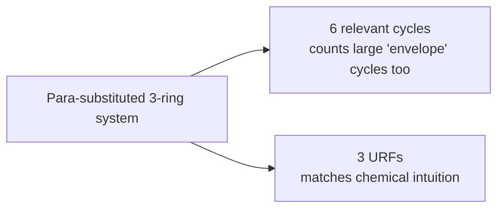

# Unique Ring Families (URF)

The ring concept that satisfies **all five** requirements of [[concepts/ring-perception]]:
chemically sensible, universal, unique, polynomial and efficiently computable.

## The problem it solves

Disadvantages of relevant cycles in molecules:

> **Para-substituted rings** lead to an **overestimation of the ring count** and to
> chemically non-intuitive statements about the number of rings an atom belongs to.

Example from the lecture: a three-ring system produces **6 relevant cycles** but only
**3 URFs**.


*Relevant cycles double-count the large cycles formed by combining fused rings; URFs group them.*

## Essential rings (an intermediate concept)

> A cycle `C ∈ C_R` is **essential** if it is contained in **all** minimal cycle bases.

- Essential cycles are **polynomial and unique**,
- but they describe **only part** of the ring structure.

## URF-pair-related and URF-related

> Two cycles `C₁, C₂` are **URF-pair-related** iff
> 1. `|C₁| = |C₂|`
> 2. `C₁ ∩ C₂ ≠ ∅`
> 3. `∃ S ⊆ { Z ∈ Ω : |Z| < |C₁| } : C₁ ⊕ (⊕_{Z ∈ S} Z) = C₂`

In words: **two cycles are of equal size, share edges, and can be transformed into each other
by adding smaller cycles.**

> **URF-related** is the **transitive closure** of URF-pair-related.

In words: for two cycles `B, D` there is a sequence `C₁, C₂, …, C_k` such that
`(B,C₁), (C₁,C₂), …, (C_k,D)` are each URF-pair-related.

**URF-related is an equivalence relation.**

## Definition

> A **URF** is an **equivalence class** of the relation URF-related.
> `|URF|` denotes the **length** of the cycles of the URF.
> The number of URFs of a graph is the **URF number**.

The URF number is bounded above by the **RCF number** and is therefore **polynomial**
([[concepts/relevant-cycles-and-vismara]]).

## Computation (Kolodzik)

```text
ALGORITHM ComputeURFs_Variant1(G)         # exponential: RCs grow exponentially
  1  compute RCPs                          # relevant cycle prototypes
  2  compute RCs                           # enumeration of the RCFs
  3  evaluate which RCs are URF-pair-related
  4  compute which RCs are URF-related     # transitive closure, equivalence classes
  5  merge all cycles of a URF into edge sets

ALGORITHM ComputeURFs_Variant2(G)         # the practical one
  1  compute RCPs
  2  evaluate which RCPs are URF-related
  3  compute the URF edge set directly from them
  # complexity: O(|E|⁵ + |V|²)
```

## Properties

| Requirement | URF |
|---|---|
| fast | ✔ < 200 ms |
| chemically sensible | ✔ |
| universal | ✔ |
| unique | ✔ |
| polynomial | ✔ |
| efficiently computable | ✔ |

**Cube example**: URFs = 6, SSSR = 5, RCs = 6.

> **Note:** URFs are, strictly speaking, **no longer cycles** but **edge sets**, which can be
> interpreted as a hierarchical set of cycles.

## See also

- [[concepts/relevant-cycles-and-vismara]]
- [[concepts/sssr-and-minimal-cycle-basis]]
- [[concepts/ring-perception]]

## Sources

- [[sources/ciw-02-substructure-search-and-ring-perception]] (pp. 24–25)
