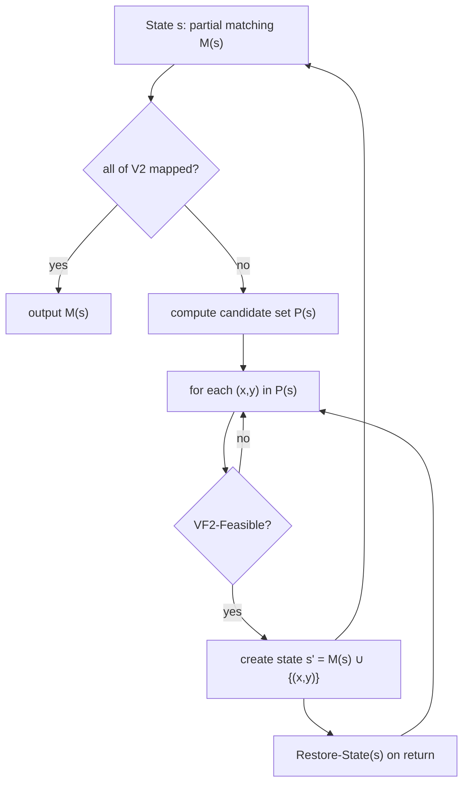

# VF2 Algorithm

A state-space search for [[concepts/subgraph-isomorphism]] that extends a partial matching
**locally** and prunes with **look-ahead**, instead of refining a global matrix like
[[concepts/ullmann-algorithm]].

## Idea

- Analysing the complete assignment matrix after every assignment step is very expensive.
- Many assignments are impossible anyway because of the neighbourhood of already assigned nodes.

⇒ **Decide locally and ad hoc** which nodes can be assigned.
⇒ Use a **look-ahead strategy** to recognise early that an assignment cannot be completed.

## State representation

Input: graph `G1 = (V1, E1)`, subgraph `G2 = (V2, E2)`. The algorithm is characterised by
**states** `s`:

| Symbol | Meaning |
|---|---|
| `M(s)` | matching in state s, `M(s) ⊆ V1 × V2` |
| `P(s)` | candidate assignments by which `M(s)` can be extended, `P(s) ⊆ V1 × V2` |
| `G1(s) = (M1(s), E1(s))` | mapped subgraph of G1 in state s |
| `G2(s) = (M2(s), E2(s))` | mapped subgraph of G2 in state s |
| `T1(s)` | nodes of V1 adjacent to a mapped node but not themselves mapped |
| `T2(s)` | nodes of V2 adjacent to a mapped node but not themselves mapped |

```text
T1(s) = { v ∈ V1 | ∃ x ∈ M1(s) : (x,v) ∈ E1 } \ M1(s)
T2(s) = { v ∈ V2 | ∃ x ∈ M2(s) : (x,v) ∈ E2 } \ M2(s)
P(s)  = { (u,v) ∈ T1(s) × T2(s) | v minimal w.r.t. ≺ }
```

## Main recursion

```text
ALGORITHM VF2-Match(state s)
  INPUT : current state s
  OUTPUT: all complete matchings

  if { x ∈ V2 | (·,x) ∈ M(s) } == V2:      # all nodes of V2 assigned
      output M(s)
  else:
      P(s) <- VF2-Calculate-P(M(s), G1, G2)     # candidate set
      for each (x,y) ∈ P(s):
          if VF2-Feasible(M(s), x, y):          # valid extension?
              s' <- Create-State(M(s) ∪ {(x,y)})
              VF2-Match(s')
              Restore-State(s)                  # remove match (x,y) from the data structures
```


*Depth-first state-space search with backtracking; feasibility tests prune the tree.*

## Candidate set P(s)

- Extend the matching `M(s)` **locally**, i.e. by a pair of nodes **adjacent to already
  assigned nodes**.
- **Matching order**: define an arbitrary but fixed order `≺` on the node set V₂.
  - Boundary condition on ≺: if `v₁,…,v_|V2|` is the order defined by ≺, then for all
    `k ∈ [1..|V2|]` the prefix `v₁,…,v_k` must be **connected** ⇒ ≺ obtained by **DFS or BFS**.
  - A match `(·, v)` is only added to `M(s)` if for all `(·, x) ∈ M(s)` it holds that `x ≺ v`.
  - ⇒ the assignment proceeds strictly along ≺, which removes duplicate search branches.

## Data structures

Representation is by flat arrays, so that only **one** copy exists and it is built up and
torn down during backtracking ⇒ **O(n) memory**.

| Structure | Meaning |
|---|---|
| `core1[i] = x`, `core2[x] = i` | mapping of node `vᵢ ∈ V1` onto `v_x ∈ V2` |
| `out1[i] = k` | if k > 0 then `vᵢ ∈ M1(s) ∪ T1(s)`; k is the recursion depth at which `vᵢ` entered that set |
| `out2[i] = k` | analogous for nodes of V2 |

### Non-connected subgraphs G₂

If `G2` is not connected, `T1(s)` and `T2(s)` become **empty**. The fix is to
(re-)initialise:

```text
T1(s) = V1 \ M1(s)
T2(s) = V2 \ M2(s)
```

⚠️ **Careful:** the nodes adjacent to `M1(s)` must be removed from `T1(s)` again:

```text
T1(s) = V1 \ M1(s) \ { u ∈ V1 | ∃ x ∈ M1(s) : (x,u) ∈ E1 }
```

## Feasibility test

The feasibility test checks whether a partial matching (state s extended by the match
`(u₁,u₂)`) can **no longer** be grown into a complete matching of the substructure.

Helper definitions:

```text
Adj(v)  = { u ∈ V | (v,u) ∈ E }                 # nodes adjacent to v
N1(s)   = V1 \ M1(s) \ T1(s)                    # unmapped nodes not adjacent to mapped nodes
```

| Rule | Purpose | Condition |
|---|---|---|
| **R_match** | consistency of the extended matching | `∀v ∈ M1(s) ∩ Adj(u₁) ∃w ∈ Adj(u₂) : (v,w) ∈ M(s)` **∧** `∀w ∈ M2(s) ∩ Adj(u₂) ∃v ∈ Adj(u₁) : (v,w) ∈ M(s)` |
| **R_adj** | 1-look-ahead: enough matching partners in the neighbourhood set | `\|Adj(u₁) ∩ T1(s)\| ≥ \|Adj(u₂) ∩ T2(s)\|` |
| **R_next** | 2-look-ahead: enough partners for the next-but-one shell | `\|Adj(u₁) ∩ N1(s)\| ≥ \|Adj(u₂) ∩ N2(s)\|` |
| **R_sem** | semantic compatibility of node and edge labels | `u₁ ≅ u₂` **∧** `∀(v₁,v₂) ∈ M(s) : (u₁,v₁) ∈ E₁ ⇒ (u₁,v₁) ≅ (u₂,v₂)` |

Combined:

```text
F(s, (u₁,u₂)) = R_match ∧ R_adj ∧ R_next ∧ R_sem
```

Compatibility functions: `≅ : E1 × E2 → {0,1}` for edges and `≅ : V1 × V2 → {0,1}` for nodes.

## Performance

Benchmark results quoted in the lecture:

| Question | VF2 | Ullmann |
|---|---|---|
| Which algorithm is faster? | ≈ 10 ms almost ever | many ≤ 10 ms, but overall 10–1000 ms |
| Effect of rings and explicit hydrogens | H implicit < 10 ms; H explicit > 10 ms; with rings slower than without | H implicit < 1000 ms; H explicit > 1000 ms; with rings ≈ 10 × without |
| Effect of molecule/pattern size | fairly constant, with or without H, with or without rings | grows with size |
| First hit vs all hits | all hits ≈ one order of magnitude slower (1 → 10 ms); **all hits linear in size, first hit constant** | roughly the same time for the first hit and for all hits |

## See also

- [[concepts/subgraph-isomorphism]]
- [[concepts/ullmann-algorithm]]
- [[exercises/ciw-e2-vf2-trace]]

## Sources

- [[sources/ciw-02-substructure-search-and-ring-perception]] (pp. 2–6)
