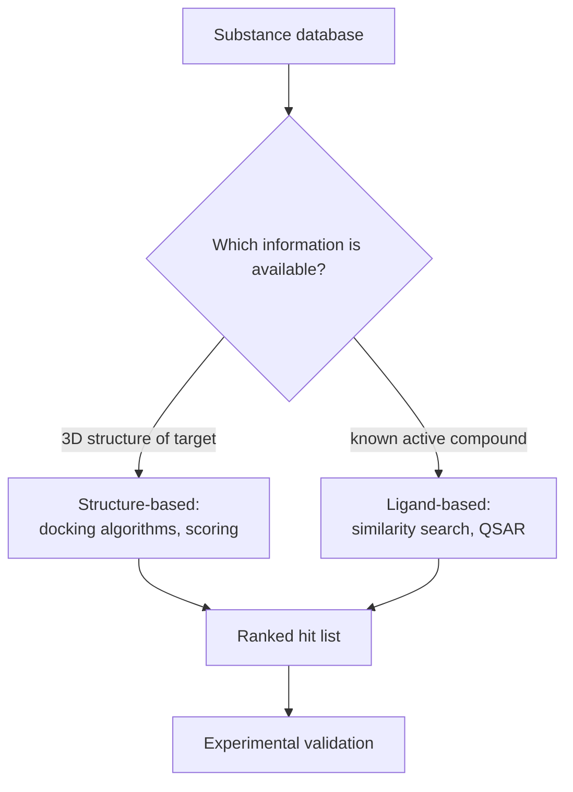

# Virtual Screening

Computer-aided search for active compounds in large substance databases.

## Two flavours

| Flavour | Starting point | Method |
|---|---|---|
| **Structure-based** | the 3D structure of the target protein | docking + scoring |
| **Ligand-based** | a known active compound | similarity searching, QSAR |


*Both routes end in a ranked list that is validated experimentally.*

## Prerequisites

- 3D structure of the target protein, **or** a known active compound
- substance databases
- docking algorithms or comparison (similarity) algorithms

## Generic procedure

```text
ALGORITHM VirtualScreening(database D, target T)
  INPUT : compound database D, target information T (3D structure or known ligand)
  OUTPUT: ranked list of candidate compounds

  candidates <- []
  for each compound c in D:
      c3d <- generateConformers(c)                  # 3D structures, torsion sampling
      if structureBased(T):
          pose  <- dock(c3d, bindingSite(T))        # search placement + conformation
          score <- scoringFunction(pose)            # estimate binding affinity
      else:
          score <- similarity(descriptors(c), descriptors(knownActive(T)))
      candidates.append((c, score))
  return topN(sortDescending(candidates))
  # complexity dominated by |D| × conformers × pose search
```

## Caveats

- Scoring functions must approximate [[concepts/binding-thermodynamics]], including
  desolvation — this is the accuracy bottleneck.
- The target is not rigid; see [[concepts/protein-flexibility]].

## Similarity-search route

GCI part 4 expands the ligand-based route: start from one or more known binders, calculate descriptors or fingerprints, search a database for high-similarity molecules, inspect common functional groups, and select a set for experimental screening.

```text
PROCEDURE LigandBasedVirtualScreen(knownBinders K, database D)
  INPUT : known binders K and database D
  OUTPUT: experimental screening shortlist

  descriptorsK <- compute descriptors or fingerprints for K
  for each molecule m in D:
      descriptorsM <- compute the same representation for m
      score[m] <- similarity(descriptorsM, descriptorsK)
  shortlist <- choose high-scoring molecules, optionally preserving diversity
  return shortlist for assay
```

## See also

- [[concepts/lead-finding-strategies]]
- [[concepts/de-novo-design]]
- [[concepts/high-throughput-screening]]
- [[concepts/protein-flexibility]]

## Sources

- [[sources/ciw-01-drug-action-and-molecular-interactions]] (pp. 18–19)
- [[sources/gci-04-molecular-glues-descriptors-fingerprints-and-similarity]] (p. 2)
