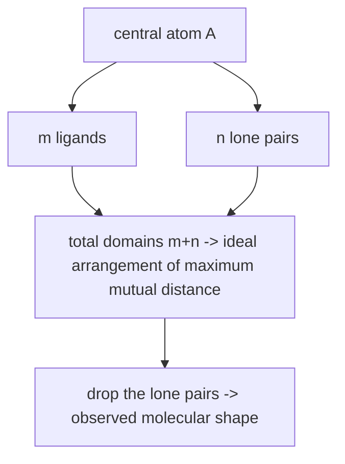

# VSEPR and LCP Models

**Valence Shell Electron Pair Repulsion** — the qualitative model that predicts local
molecular geometry, and therefore supplies the ideal bond angles used by
[[concepts/conformation-generation]].

## Idea

- Molecular geometry is **primarily determined by the arrangement of the electron pairs
  around a central atom**.
  ⇒ **Lone pairs have just as large an influence on the geometry as bonding pairs.**
- Electron pairs take up a geometric arrangement with the **maximum possible pairwise
  distance** from one another.

## Physical basis

```text
electrons with the same spin occur in spatial proximity with low probability   (Pauli principle)
electrons with opposite spin do not have this property                         (formation of electron pairs)
```

## AXₘEₙ notation

The geometry is determined by the number of **ligands m** and the number of **lone pairs n**:

| m – n | Geometry |
|---|---|
| 3 – 0 | trigonal planar (*eben*) |
| 2 – 1 | bent (*gewinkelt*) |
| 4 – 0 | tetrahedral |
| 3 – 1 | trigonal pyramidal |


*Count all electron-pair domains to get the arrangement, then describe only the positions of the ligands.*

## Reasons for deviations from the ideal geometry

- **Domains of lone pairs are larger than domains of bonding pairs.** The shape is not
  spherical; the domains have a rather large opening angle.
- The size of a bonding-pair domain is influenced by the **electronegativity** of the bonded
  atoms:

```text
rising EN of the ligand        ⇒ shrinking size of the domain
falling EN of the central atom ⇒ shrinking size of the domain
```

- **Unbonded atoms with full electron shells repel each other.** An atom can be assigned a
  radius from which a minimum distance follows; the radius depends on the EN of the atom.
  (**LCP model** — *ligand close packing*.)

Example: water, `H–O–H = 104.45°` rather than the ideal tetrahedral 109.5°, because the two
lone pairs claim more space than the two bonds.

## Bond lengths — atomic radii

Under the **assumption of additivity**, an interaction distance between two atoms can be
approximated by atom-specific radii `r_a`, `r_b`:

> **Covalent atomic radius:** the sum approximates the bond length (depending on bond type,
> ion, etc.).

⚠️ Additivity is an assumption, and the same one that failed for binding free energies in
[[concepts/enthalpy-entropy-compensation]] — here it happens to work well.

## Bond angles

Deviation by **repulsion of large ligands**, and by **false atom typing**:

```text
sp3 reference   ~ 112°
allene / ketene  132° … 180°   (delocalisation)
```

## Further geometric parameters: planarity

Planarity at double bonds and amide bonds:

| Bond | Torsion |
|---|---|
| Double bond | 0° or 180° |
| **Primary amide** `R–CO–NH₂` | 0° and 180°, both frequent |
| **Secondary amide** `R–CO–NH–R` | 0° and 180°, both frequent |

## Conclusion

> **VSEPR / LCP describe local molecular geometry qualitatively very well.**
>
> Molecular geometries are influenced by many properties, in particular by the
> **repulsion of large molecular parts** and by **delocalisation**.

The word to keep is *local*: VSEPR fixes angles at one centre but says nothing about how
distant parts of the molecule arrange — that is the job of conformational search.

## See also

- [[concepts/molecular-conformation]]
- [[concepts/conformation-generation]]
- [[concepts/molecular-structure-and-stereochemistry]]
- [[concepts/lennard-jones-potential]]

## Sources

- [[sources/ciw-04-descriptor-evaluation-clustering-and-superposition]] (pp. 17–19)
