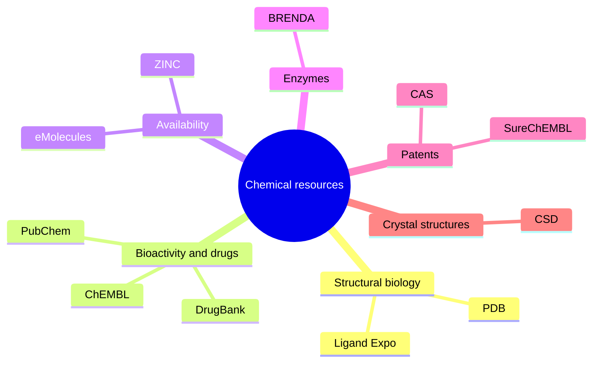

# Chemical Database Catalog

The GCI source catalogues databases and search engines for structures, biological profiles, commercial availability, enzyme data, drugs, patents and crystal structures.

## Why it matters

Choosing the wrong database gives the wrong universe of molecules: purchasable compounds, approved drugs, enzyme records and crystal structures answer different questions.

## How it works

*The catalog groups resources by the evidence type associated with them in GCI.*

## Practical notes

- PDB identifiers point to protein structures; Ligand Expo is the PDB-linked ligand resource.
- CSD is highlighted for molecular/crystal structures and atom coordinates.
- DrugBank exercise questions distinguish approved and withdrawn drugs and require duplicate removal.

## Limitations / caveats

- The source gives a survey list, not detailed schemas or licensing conditions.

## See also

- [[concepts/chemical-databases-and-search-engines]]
- [[concepts/molecular-file-formats]]
- [[concepts/markush-structures]]

## Sources

- [[sources/gci-01-foundations-of-cheminformatics]] (pp. 3–5, 8, 11)
