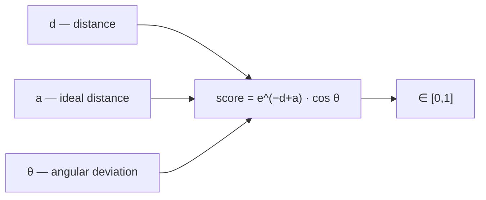

# Exercise E1 — Thermodynamics and Hydrogen Bonds

Exercise sheet accompanying lecture 1 (pages 21–22 of the summary).

## Part 1 — Enthalpy and entropy (tasks 1–3)

**Task.** For four ligands measured at two pH values, compute ΔG and Kᵢ from ΔH and ΔS.

**Formulas**

```text
ΔG = ΔH − T·ΔS      [kJ/mol]
ΔG = R·T·ln Kᵢ   ⇒   Kᵢ = e^(ΔG / RT)
```

**Data and results** (T = 300 K)

| Ligand | pH | ΔH [kcal/mol] | ΔS [cal K⁻¹ mol⁻¹] | ΔG [kJ/mol] | Kᵢ |
|---|---|---|---|---|---|
| 1 | 7.4 | −8.87 | 2.83 | −40.6 | 8.22 E−08 |
| 1 | 8.5 | −10.41 | −5.79 | −36.3 | 4.7 E−07 |
| 2 | 7.4 | 6.03 | 50.9 | −38.6 | 1.8 E−07 |
| 2 | 8.5 | 2.91 | 37.9 | −35.4 | 6.7 E−07 |
| 3 | 7.4 | 1.65 | 38.8 | −41.8 | 5.0 E−08 |
| 3 | 8.5 | −4.76 | 14.3 | −38 | 2.4 E−07 |
| 4 | 7.4 | −9.98 | −8.4 | −31.1 | 3.7 E−06 |
| 4 | 8.5 | −10.24 | −9.27 | −31.2 | 3.6 E−06 |

**Worked example (ligand 1, pH 7.4)**

```text
ΔG = −8.87 kcal/mol − 300 K · 0.00283 kcal/(K·mol)
   = −9.731 kcal/mol
   = −9.731 · 4.1868 kJ/kcal
   = −40.7417 kJ/mol
Kᵢ = e^(ΔG / RT)
```

## Part 2 — Task 5: energetic vs entropic binding

**Question.** Is the binding of the ligands due to energetic or entropic effects?

| Ligand | Assessment | Interpretation |
|---|---|---|
| 1 | energetic effects ≥ entropic effects | — |
| 2 | energetic effects ≪ entropic effects | large free tail |
| 3 | energetic effects ≤ entropic effects | rigid ring |
| 4 | energetic effects ≫ entropic effects | rigid ring |

**Rule of thumb**

```text
Big energetic effect : ΔH ≪ 0
Big entropic effect  : ΔS ≫ 0
```

A large, flexible tail that becomes ordered on binding shows up as a **large entropic**
signature; a rigid ring locked into the active conformation shows up as an **enthalpic**
signature. See [[concepts/enthalpy-entropy-compensation]].

## Part 3 — Hydrogen bonds (task 1-something)

**1) Criteria for scoring a single hydrogen bond**

- **Distance** between acceptor and donor
- **Orientation** — correct orientation: the H points towards the acceptor and the donor atom
  points towards the hydrogen-bond donor
- **Geometry** — the hydrogen bond should be planar (ideal 180°)
- **Context** — evaluated in the context of the protein–ligand interaction; e.g. buried
  hydrogen bonds are more stable than those on the surface

**2) Criteria for scoring a hydrogen-bond network between protein and ligand**

- **Network topology**, including the number of hydrogen bonds
- **Cooperativity** — degree of interaction between multiple hydrogen bonds
- **Dynamics** — flexibility and mobility of the residues
- **Accessibility** — location in the network; buried is more stable

**3) As a function**

```text
ALGORITHM HBondScore(d, θ, a)
  INPUT : d = actual donor–acceptor distance
          a = minimal (ideal) distance
          θ = angle deviation, measured on  –O–H···O=
  OUTPUT: score ∈ [0, 1]      1 = best, 0 = worst

  score <- exp(−d + a) · cos(θ)
  return score
```


*The exponential term penalises distance, the cosine term penalises non-linearity.*

## What this exercise teaches

- Fluency with unit conversion: kcal ↔ kJ (factor 4.1868), cal ↔ kcal (factor 1000).
- That ΔG can be nearly identical for ligands with completely different ΔH/ΔS splits —
  the practical face of [[concepts/enthalpy-entropy-compensation]].
- How a geometric criterion becomes a smooth, bounded **scoring term** usable in docking.

## See also

- [[concepts/binding-thermodynamics]]
- [[concepts/hydrogen-bond]]
- [[concepts/enthalpy-entropy-compensation]]

## Sources

- [[sources/ciw-01-drug-action-and-molecular-interactions]] (pp. 21–22)
