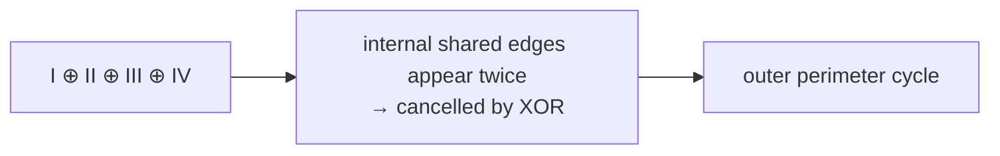

# Exercise E3 — Cycle Bases, Linkers and Chains

## Task 3-1: Cycle bases

### 1) Vector bases vs cycle bases

| | Vector bases | Cycle bases |
|---|---|---|
| What they span | a dimension | all cycles in the molecule |
| Independence | linearly independent (vector addition and multiplication) | linearly independent (**XOR** and **AND** on edge vectors) |
| Size | `dim(M_B)` | `μ(G)` |

Both **span**; the cycle basis is the special case where the field is GF(2) and the vectors
are edge-incidence vectors. See [[concepts/cycle-space-and-cycle-basis]].

### 2) Minimal cycle bases

For the drawn fused-ring molecule, a minimal cycle basis is

```text
C_B = { I, II, III, IV }
```

(two hexagons I and II, a small ring III, and one larger envelope cycle IV).

### 3) Sum of the basis

```text
⊕_{C ∈ C_B} C  =  the outer perimeter cycle
```
Adding all basis cycles cancels every internal (shared) edge and leaves the **outer boundary**
of the ring system.


*XOR of a full cycle basis yields the perimeter, because every interior edge is covered an even number of times.*

### 4) Essential vs non-essential relevant cycles

Set of all relevant cycles: I, II, III, IV, V, VI.

| Class | Cycles |
|---|---|
| **Essential** (in every minimal basis) | I, II, III |
| **Non-essential** | IV, V, VI |

- *Atom and bond such that all non-essential cycles are part of the **same** RCF*: an atom/bond
  lying on the shared boundary — all three large cycles then have the same root node `r` and
  the same edge `e`, so they fall into one family `{IV, V, VI}`.
- *Is there a pair of atom and bond such that the non-essential cycles are part of **more than
  one** RCF?* Yes — choosing a different root splits them into `{IV, V}` and `{VI}`.

See [[concepts/relevant-cycles-and-vismara]] and [[concepts/unique-ring-families]].

## Task 3-2: Linkers and chains

**Definition.** A bond is part of a **linker** iff removing it causes the molecule to split
into multiple connected components that contain **at least one ring each**.

Full algorithm and pseudocode: [[concepts/linkers-and-chains]].

```text
GetDiverseAtomSets(mol) -> cyclic_atom_set, linker_set, chain_set
is_linker_atom(mol, root, lows, cyclic_atoms) -> bool
  step 1: for every neighbour, DFS to check whether it reaches a ring
          (cyclic AND with a different low point than root)
  step 2: check whether at least two neighbours are no longer connected
          to each other once root is removed
  return ring_in_neighbors == adjacency_count
```

## What this exercise teaches

- Why a cycle basis is literally a **basis of a vector space over GF(2)**, and what the sum of
  a full basis means geometrically (the perimeter).
- The difference between *essential*, *relevant* and *basis* cycles on a concrete molecule.
- That RCF membership depends on the chosen node order ≺ — which is exactly why RCFs are a
  **non-unique** partitioning while URFs are unique.
- That "linker vs chain" is decided by a **connectivity + ring-reachability** test, not by
  bond type.

## See also

- [[concepts/cycle-space-and-cycle-basis]]
- [[concepts/sssr-and-minimal-cycle-basis]]
- [[concepts/relevant-cycles-and-vismara]]
- [[concepts/unique-ring-families]]
- [[concepts/linkers-and-chains]]

## Sources

- [[sources/ciw-02-substructure-search-and-ring-perception]] (pp. 26–29)
