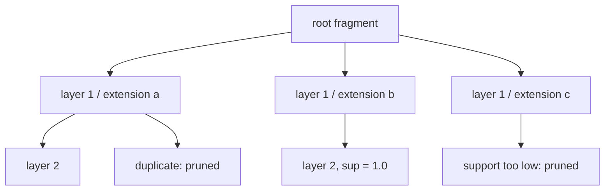

# Exercise 4 — MoSS Search Tree, KNIME MoSS, Ball-Pivoting

Sheet "CiW – Ex 4", split across the lecture-3 scan: tasks 4-1 and 4-2 on pp. 6–7, task 4-3
on p. 19.

## Task 4-1 — Trace the MoSS search tree

Draw the search tree for a frequent-pattern search over a small molecule set, using the
canonical extension rules of [[concepts/moss-algorithm]].

**What the worked solution shows:**

- The root is the start fragment; **layer 1** enumerates the single-bond extensions.
- Atoms carry ascending **order numbers** (0, 1, 2, 3, 4, 5, …) assigned in insertion order.
- Extensions are generated in the bond order **single ≺ double** (the sheet annotates
  exactly this at the point where a branch is pruned), which is the rule
  `single ≺ aromatic ≺ double ≺ triple`.
- Branches are struck out when they are duplicates of an already-processed pattern
  (**structural pruning** / **equivalent-sibling pruning**) or when the support falls below
  the threshold.
- Nodes that survive are annotated with their support (e.g. `1.0` for patterns present in
  every molecule).


*Shape of the traced tree: one bond per layer, with duplicate and low-support branches struck out.*

**Points to remember for the exam:**

- Extend only at atoms whose order number ≥ the order number of the atom added last.
- Forbid ring-closure bonds from a high order number to a lower one.
- Support falls monotonically down the tree — this justifies the pruning.

## Task 4-2 — KNIME MoSS node

Run the **MoSS** node in KNIME and interpret its parameters.

| Parameter | Meaning |
|---|---|
| **Maximum complement support** | sensitivity of the MoSS algorithm in identifying significant patterns, by defining the relative % of instances that can support the **complement** of a pattern |
| **Minimum focus support** | the relative % of instances **in the focus class** that must support the pattern |
| **Max number of fragments** | cap on the reported output |

Settings used in the solution:

```text
Max complement support   ( % not in class A )  = 0
Min focus support        ( % in class A )      = 50
```

⇒ patterns reported occur in **≥ 50 % of class A** and in **0 % of the complement** — i.e.
strict contrast patterns, cf. [[concepts/frequent-pattern-mining]].

**Interpretation noted on the sheet:** MoSS measures the *similarity between substrates of
similar proteins* — the discovered fragments are shared recognition elements.

## Task 4-3 — Ball-Pivoting Algorithm

Four sub-questions, answered in [[concepts/ball-pivoting-algorithm]]:

1. **What is BPA?** A surface-reconstruction method that generates triangle meshes from
   unorganised point-cloud data; it iteratively constructs triangles by pivoting balls of a
   fixed radius around the points.
2. **Which family of interpolation techniques?** Rolling a ball around the molecule →
   triangulation methods / mesh-generation algorithms.
3. **Effect of the ball radius?** The smaller the radius, the smaller and more accurate the
   result and the higher the level of detail; **too small** → overly sensitive to noise.
4. **Edge labels?** *active* (initially all edges, candidates for triangles), *boundary*
   (part of the boundary of the reconstructed mesh), *frozen* (already used for triangles,
   no unprocessed points left in its adjacent region). An edge goes **active → boundary**
   when an adjacent point has no neighbouring points within the point cloud at radius `r`.

## See also

- [[concepts/moss-algorithm]]
- [[concepts/frequent-pattern-mining]]
- [[concepts/ball-pivoting-algorithm]]
- [[concepts/molecular-surfaces]]

## Sources

- [[sources/ciw-03-pattern-mining-diagrams-surfaces-and-reduced-graphs]] (pp. 6–7, 19)
