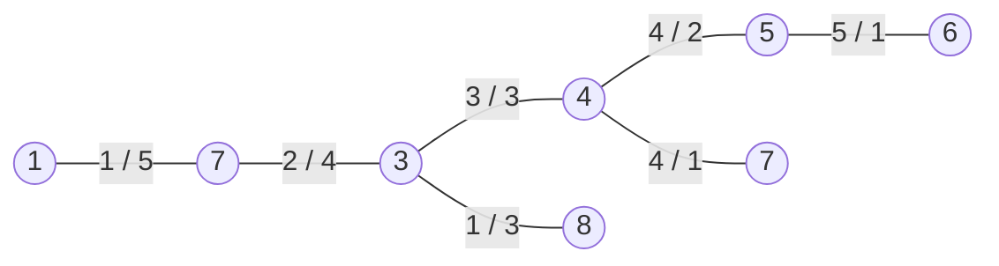

# Exercise 5 — Feature Trees and Clustering

Sheet "CiW – Ex 5". Task 5-1 is on the last page of the lecture-3 scan; task 5-2 appears
inside the lecture-4 scan.

## Task 5-1 — Match-search traversal order

Given two feature trees, determine the **order in which the dynamic-programming matrix is
computed** — i.e. the traversal order over the tree edges, where **each edge is processed in
both directions**.

The worked solution is a tree whose edges are annotated with a number per direction:

```text
        (1)
       1 |  5
        (7)
       2 |  4
        (3) ──3/3── (4) ──4/2── (5) ──5/1── (6)
       1 |  3        4 | 1
        (8)          (7)
```

Reading of the annotation: the pair of numbers on an edge gives the step at which that edge
is evaluated **in each of its two directions**. Leaf-directed evaluations come first (low
numbers), root-directed evaluations last — the classic post-order/pre-order pair of a
tree dynamic program.


*Each edge carries two evaluation indices, one per direction; the matrix cells are filled in that order.*

**Why both directions.** A subtree of an unrooted tree is defined by a *directed* edge:
edge `(u,v)` taken from `u` to `v` designates the part hanging off `v`. Since the
match-search must be able to root the comparison anywhere, every edge must be evaluated
once per direction. That gives `2·(n−1)` subtrees and hence `2·(n−1)` matrix rows/columns,
which is what makes the dynamic program polynomial instead of exponential.

**Dependency rule for the order:** a directed edge `(u→v)` can only be evaluated once all
directed edges `(v→w)` for `w ≠ u` have been evaluated — its subtree is built from theirs.

## Task 5-2 — Partitional vs hierarchical clustering

Compare the two clustering families and state the classical linkage definitions.

| | Partitional clustering | Hierarchical clustering |
|---|---|---|
| Idea | divides a dataset into distinct groups based on similarity/distance measures | organises data points into a hierarchy of nested clusters forming a tree-like structure |
| Assignment | each point to exactly one cluster | bottom-up or top-down |
| **+** | simple | no need to know the number of clusters |
| **+** | scalability | captures complex relationships |
| **+** | flexibility | visualisation |
| **−** | sensitivity to initial conditions | complex |
| **−** | difficult to determine the number of clusters | lack of scalability |
| **−** | unable to handle overlapping clusters | difficult to interpret large dendrograms |
| Used when | the number of clusters **is known** | the number of clusters is **unknown** |

Linkages asked for in the solution:

```text
single linkage    f'(A,B) = min_{a∈A, b∈B} f(a,b)
complete linkage  f'(A,B) = max_{a∈A, b∈B} f(a,b)
average linkage   f'(A,B) = (1/(|A|·|B|)) Σ_{a∈A, b∈B} f(a,b)
```

→ [[concepts/clustering-of-molecules]], [[concepts/hierarchical-clustering]],
[[concepts/k-means-clustering]]

## Open

Only tasks 5-1 and 5-2 appear in the scans (5-1 at the end of lecture 3, 5-2 inside
lecture 4). → [[open-questions]]

## See also

- [[concepts/feature-trees]]
- [[concepts/feature-tree-comparison]]
- [[concepts/reduced-graphs]]

## Sources

- [[sources/ciw-03-pattern-mining-diagrams-surfaces-and-reduced-graphs]] (p. 27)
- [[sources/ciw-04-descriptor-evaluation-clustering-and-superposition]] (p. 12)
