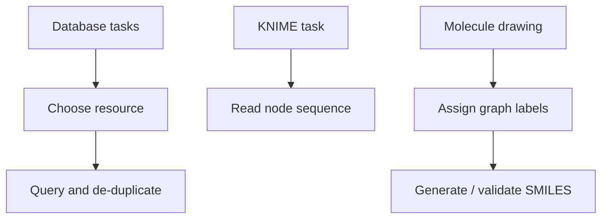

# GCI Exercise 1 — Databases, Workflows and SMILES

This exercise sheet practices chemical database lookup, workflow construction and hand conversion between molecular drawings and SMILES.

## Task themes

- Query DrugBank for approved and withdrawn drugs, removing duplicates before counting.
- Use PubChem, PDB/Ligand Expo and BRENDA for small-molecule, protein/ligand and enzyme context.
- Interpret a KNIME workflow with reader, RDKit molecule conversion, rule engine, shuffle, row splitter, joiner and writer nodes.
- Compare SDF, mol2 and SMILES fields.
- Convert line drawings into SMILES with branches, ring labels, aromatic atoms and stereochemistry.
- Identify proposed SMILES strings that cannot be produced by a DFS traversal of the whole graph.

## Approach

```text
PROCEDURE SolveGCIDatabaseAndSMILESExercise(tasks)
  INPUT : database questions, workflow sketch and molecule drawings
  OUTPUT: checked answers and valid SMILES strings

  for each database question:
      choose database by evidence type
      query molecule, protein, enzyme or drug status
      remove duplicates when counting molecules
  inspect workflow nodes and record each transformation
  for each drawing:
      assign atom labels, implicit hydrogens, charges and stereochemistry
      choose a traversal start atom
      emit SMILES using DFS, branches and ring numbers
      check whether the traversal covers the whole molecule
```


*The exercise combines resource selection, workflow interpretation and graph-to-string conversion.*

## Solution sketch

- DrugBank questions distinguish structurally similar or identical molecules from activity-similar molecules; similarity is assessed by a score.
- PDB structure selection criteria include resolution, source organism / taxonomy, experimental method and source name.
- A valence check explains explicit bracket atoms such as `[Au]`, `[Cu+2]`, `[13C]` and `[NH4+]`.
- Complex molecules can have many valid non-canonical SMILES because DFS order changes the string.

## What it teaches

- Database answers depend on curation and preprocessing.
- Workflow systems expose data-cleaning choices.
- SMILES is a graph traversal notation, not a drawing language.

## See also

- [[concepts/chemical-databases-and-search-engines]]
- [[tools/knime]]
- [[concepts/smiles]]
- [[concepts/smiles-generation]]
- [[concepts/molecular-file-formats]]

## Sources

- [[sources/gci-01-foundations-of-cheminformatics]] (pp. 8, 11–12, 15–35)
