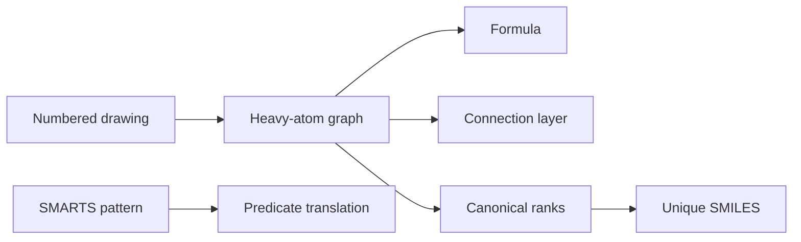

# GCI E2 - Identifiers, Canonicalization and SMARTS

This exercise practises translating between molecular drawings, InChI connection layers, canonical atom orderings and SMARTS patterns.

## Tasks

1. Write or interpret an InChI main layer for a branched/aromatic molecule by separating formula, connection layer and hydrogen layer.
2. Identify an erroneous canonicalisation caused by an incorrect atom ordering.
3. Apply Morgan-style ranking and CANON/GENES-style tie-breaking to small graphs.
4. Read SMARTS atom and bond expressions and predict what chemical substructures they match.
5. Generate a connection layer and a canonical SMILES-like string for a larger drug-like example.

## Approach

```text
PROCEDURE SolveIdentifierExercise(drawing)
  INPUT : numbered molecular drawing
  OUTPUT: identifier fragments and canonical traversal notes

  extract heavy-atom graph and atom labels
  compute molecular formula by Hill order
  write heavy-atom connectivity from the canonical numbering
  add hydrogen layer separately
  compute initial atom ranks from atom properties and neighbours
  refine ranks or enumerate ties until the order is stable
  print the line notation using the resulting order
```

```text
PROCEDURE InterpretSMARTSExercise(smarts)
  INPUT : SMARTS expression from the sheet
  OUTPUT: plain-English match description

  split the expression into atom and bond primitives
  translate each primitive into a chemical predicate
  apply logical operators in precedence order: !, &, comma, semicolon
  if recursive SMARTS is present, describe the required environment
  return the class of substructures matched by the pattern
```


*The exercise connects the same graph to identifiers, canonical strings and query patterns.*

## Solution sketch

- InChI construction separates the molecular formula from connectivity and hydrogen information; hydrogens are not simply interleaved with every heavy atom in the connection layer.
- Morgan examples demonstrate that equal local environments can produce tied CVs, so canonicalisation must sometimes enumerate alternatives.
- CANON/GENES traces show that the minimum final ordering is chosen after considering tie-breaking candidates, not after a single arbitrary DFS.
- SMARTS examples include halogen wildcards (`F, Cl, Br, I, At`), three-atom heterocyclic fragments, aromatic NH environments and alpha-amino-acid-like environments.
- The larger exercise molecule shows why exact numbering must be normalised before a string can be used as an identifier.

## What it teaches

- Identifiers, canonical strings and SMARTS all start from the same labelled graph but answer different questions: identity, deterministic serialisation and substructure matching.
- A valid string is not necessarily a canonical string.
- Query syntax is intentionally more general than molecule syntax.

## See also

- [[concepts/inchi-and-inchikey]]
- [[concepts/molecular-canonicalization]]
- [[concepts/morgan-canonicalization]]
- [[concepts/canon-smiles-algorithm]]
- [[concepts/smarts]]

## Sources

- [[sources/gci-02-inchi-canonical-smiles-and-smarts]] (pp. 5-6, 11-13, 23-29)
